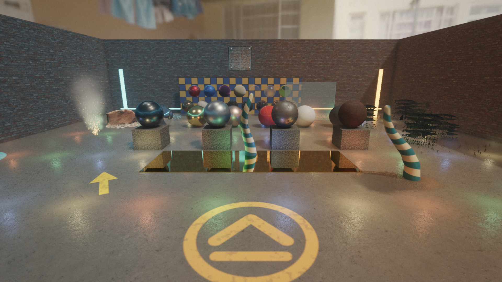

# Zenith Engine

Zenith is an educational C++20 game-engine project intended to grow into a
reusable foundation for future games: a Vulkan 1.4 renderer, Jolt physics, an
EnTT scene, hot-reloaded C++ game modules, and a Blender-style editor.



*The renderer showcase (`projects/showcase.zenith-project`), rendered by
Zenith.*

# Notes from Ian

At the start of this project the plan was that I would write every line of code myself, with no AI. As I slogged through the Vulkan boilerplate, I began to question why I was so determined to learn the syntax. Software engineering has fundamentally changed, so instead of clinging to my desire to return to a now distant past where syntax knowledge was a necessity for every software engineer, I have been using this project to try a different approach to learning. Instead of writing code by hand to learn the concepts, I write extensive prompts for the agents by hand instead. I am focusing on understanding the fundamental concepts of computer graphics rather than specific implementation details and I plan on recording what I am learning onto my website [cgfrog.org](https://cgfrog.org/).

## Documentation

**Start at [`docs/README.md`](docs/README.md).** It routes you to:

- the **[User guide](docs/guide/README.md)**: install, the editor, building
  levels, playing and debugging, writing game logic in C++, gameplay
  services, how the engine works, and shipping, plus a cookbook and glossary;
- the **[first-person game tutorial](docs/tutorials/fps-game/README.md)**, a
  complete game from the First-Person Shooter template;
- contributor references: the [code map](docs/CODE_MAP.md),
  [contributor playbook](docs/CONTRIBUTOR_PLAYBOOK.md),
  [repository guide](docs/REPOSITORY_GUIDE.md),
  [architecture](docs/ARCHITECTURE.md), and
  [development guide](docs/DEVELOPMENT.md).

AI coding agents: [`AGENTS.md`](AGENTS.md) is the contributor policy and
[`CLAUDE.md`](CLAUDE.md) adds a fast-navigation guide.

## Quick start

Requirements: CMake 3.25 or newer, a C++20 compiler (Visual Studio 2022+ on
Windows, GCC or Clang on Linux), Git, Python 3, and a Vulkan 1.4-capable GPU
and driver. Dependencies are pinned and downloaded by CMake on the first
configure.

```powershell
cmake --preset default            # configure build/
cmake --build --preset debug      # engine, editor, game runner, tests
build/Debug/zenith_editor.exe     # the editor; opens the Project Hub
```

Then create a project from a template in the Project Hub and follow
[Getting started](docs/guide/01-getting-started.md).

Play a project outside the editor with the game runner:

```powershell
build/Debug/zenith.exe --project projects/demo.zenith-project
```

Run the fast CPU-only tests:

```powershell
ctest --preset debug-cpu
```

`tools/check.ps1` builds, runs those tests, and formats changed C++ files in
one step; see [Development](docs/DEVELOPMENT.md) for smoke tests, benchmarks,
and build-speed options.

## What is in the engine

| Area | Highlights | Docs |
| --- | --- | --- |
| Rendering | Vulkan 1.4, dynamic rendering, bindless materials, GPU-driven culling, Cook–Torrance GGX PBR, clustered lights, cascaded and local shadows, GTAO, SSR, volumetric fog, particles, decals, TAA/FSR, depth of field, motion blur, bloom, AgX tone mapping, colour grading. | [Graphics](docs/engine/graphics.md) |
| Scene | EnTT ECS, explicit reflection, versioned JSON scenes with migrations, prefabs with overrides and nesting, collections, additive and asynchronous loading. | [Scene](docs/engine/scene.md) |
| Gameplay | Hot-reloaded C++ game modules, systems, behaviours, events, timers, entity commands, effects, deterministic random streams, data tables, save games. | [Game modules](docs/engine/modules.md), [Gameplay](docs/engine/gameplay.md) |
| Physics | Jolt behind ECS components: rigid bodies, sensors, character controllers, queries, 32 collision layers. | [Physics](docs/engine/physics.md) |
| Assets | glTF 2.0 import, generational handles, GUIDs and `.meta` sidecars, offline BC7/BC5 texture cooking, derived-data cache. | [Assets](docs/engine/assets.md) |
| Audio, input, UI | SDL audio with spatial voices and streaming music; device-independent input actions with gamepad support; resolution-independent game UI and menus. | [Audio](docs/engine/audio.md), [Input](docs/engine/window-input.md), [UI](docs/engine/ui.md) |
| Navigation, animation | Recast/Detour navigation meshes and agents; skeletal animation with an animator state machine. | [Navigation](docs/engine/navigation.md), [Animation](docs/engine/animation.md) |
| Editor | Blender-style areas and workspaces, operators and rebindable keymaps, multi-viewport editing, prefab windows, live Play-mode editing, build and IDE integration, packaging. | [User guide](docs/guide/02-editor-tour.md) |

## Code style

The C++ sources follow the repository's `.clang-format` (clang-format 19 or
newer). Control statements always use braces. See [`AGENTS.md`](AGENTS.md)
for the full contributor policy.
