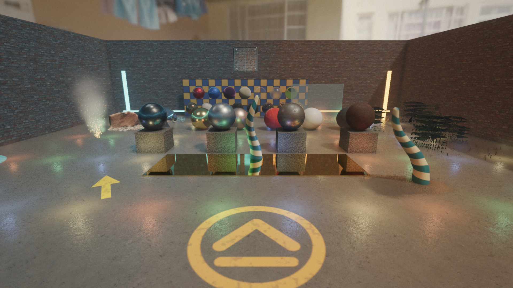

# Zenith documentation

Start here. Pick the path that matches what you want to do; every page links
onward, so you never need to search the tree.

## I want to make a game

Read the [User guide](guide/README.md) in order. It is written for people
who have never opened the Zenith editor:

| # | Chapter | You will learn |
| --- | --- | --- |
| 1 | [Getting started](guide/01-getting-started.md) | Build Zenith, open the Project Hub, create a project. |
| 2 | [The editor at a glance](guide/02-editor-tour.md) | Workspaces, panels, camera navigation, search, and keys. |
| 3 | [Building a level](guide/03-building-levels.md) | Entities, components, models, materials, lights, prefabs, collections. |
| 4 | [Playing and debugging](guide/04-play-and-debug.md) | Play, Simulate, live edits, watches, logs, and debug drawing. |
| 5 | [Writing game logic](guide/05-game-logic.md) | Game modules, components, systems, and behaviours in C++. |
| 6 | [Gameplay services](guide/06-gameplay-services.md) | Input, physics queries, events, timers, spawning, UI, audio, randomness, data tables. |
| 7 | [How the engine works](guide/07-engine-concepts.md) | The frame, the ECS, coordinates and transforms, assets, rendering, physics. |
| 8 | [Shipping a game](guide/08-shipping.md) | Running outside the editor, packaging, and testing a game. |
| – | [Cookbook](guide/cookbook.md) | Short recipes for common tasks. |
| – | [Glossary](guide/glossary.md) | Every Zenith term in one place. |

Then do the hands-on [first-person game tutorial](tutorials/fps-game/README.md),
which builds a complete target range from the First-Person Shooter template.

## I want to work on the engine or editor itself

| Document | Purpose |
| --- | --- |
| [`AGENTS.md`](../AGENTS.md) | Contributor policy: priorities, boundaries, style, verification. |
| [Code map](CODE_MAP.md) | Feature → file → symbol → test lookup. The fastest way to find an implementation. |
| [Contributor playbook](CONTRIBUTOR_PLAYBOOK.md) | Step-by-step checklists for the common change types (new component, operator, render pass, test...). |
| [Repository guide](REPOSITORY_GUIDE.md) | Directory map, build targets, dependencies, and the index of subsystem docs. |
| [Architecture](ARCHITECTURE.md) | Dependency direction, ownership, startup, the frame, render flow, error model. |
| [Development](DEVELOPMENT.md) | Configure, build, test, smoke, benchmark, format. |
| [Editor extensions](EDITOR_EXTENSIONS.md) | Operators, panels, sidebar tabs, inspectors, and menus from a game module. |
| [Releasing](RELEASING.md) | Release artifacts, packaging, and verification. |

Subsystem reference pages live in [`engine/`](REPOSITORY_GUIDE.md#subsystem-docs),
[`editor/`](REPOSITORY_GUIDE.md#subsystem-docs), and [`game/`](game/demo.md).

## Plans and validation

| Document | Purpose |
| --- | --- |
| [Gameplay roadmap](GAMEPLAY_ROADMAP.md) | Phased plan and status for gameplay programming. |
| [Roguelike readiness review](ROGUELIKE_READINESS_REVIEW.md) | Prioritised gaps before the roguelike project. |
| [Performance roadmap](PERFORMANCE_ROADMAP.md) | Measured CPU/GPU objectives and their gates. |
| [Renderer validation](RENDERER_VALIDATION.md) | Image-regression, performance, and Vulkan smoke gates. |
| [Streaming validation](STREAMING_VALIDATION.md) | Streaming measurement procedure. |
| [Next steps](NEXT_STEPS.md) | Milestone history and the recommended next slice. |

## Screenshots

The user guide marks every place that needs an image with a
`📷 Screenshot needed` callout and a stable ID. The full checklist, with the
file name each image should be saved as, is
[guide/SCREENSHOTS.md](guide/SCREENSHOTS.md).
