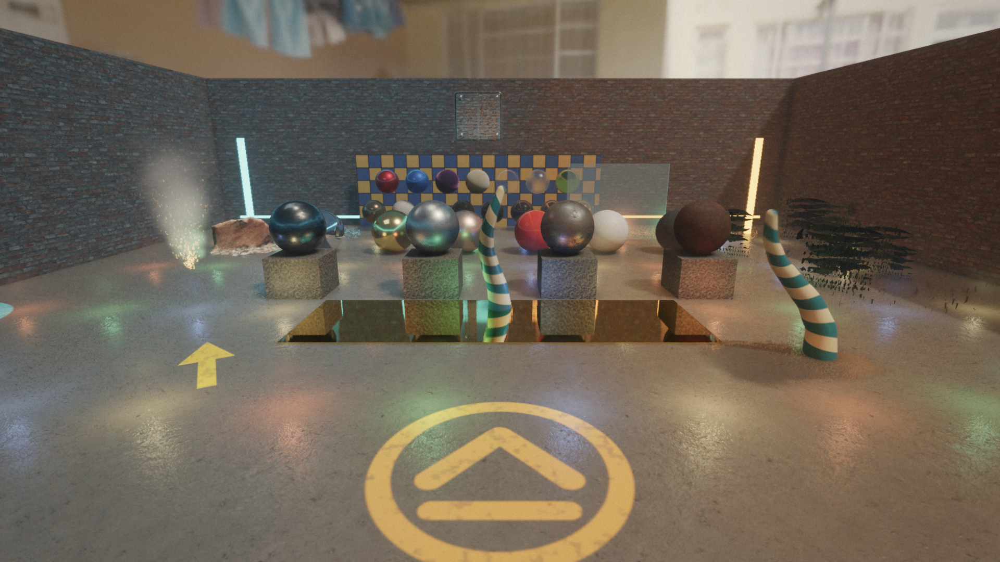

# Repository guide

This guide is a map of Zenith's checked-in files. It explains what each element
owns, what depends on it, and where a change belongs. For the runtime sequence
and subsystem contracts, see [Architecture](ARCHITECTURE.md). For commands and
common changes, see [Development](DEVELOPMENT.md). The remaining optimization
objectives and their measurement gates are in
[Performance roadmap](PERFORMANCE_ROADMAP.md).

## Top level

| Path | Purpose |
| --- | --- |
| `CMakeLists.txt` | Declares the C++20 project, pins third-party dependencies, builds the engine, executable, shaders, assets, and tests, and supplies runtime directory definitions. |
| `README.md` | Quick-start overview, controls, current feature summary, and links into these detailed guides. |
| `AGENTS.md` | Root contributor policy and navigation. Scoped guides under `src/engine/`, `src/editor/`, `src/game/`, and `tests/` add local ownership rules. |
| `.clang-format` | Formatting rules for C++ headers and sources. |
| `.gitignore` | Excludes generated and local files such as the build tree. |
| `.vscode/` | Optional editor configuration. It is not required by the build. |
| `assets/` | Source runtime content copied into the build tree. |
| `shaders/` | GLSL source compiled to SPIR-V during the build. |
| `src/` | Application composition and reusable engine implementation. |
| `tests/` | CPU-side subsystem and integration tests registered with CTest. |
| `tools/showcase/` | Blender and Python scripts that regenerate the renderer showcase content. |
| `tools/irradiance_room/` | Standard-library Python script that regenerates the irradiance-volume test interior. |
| `tools/color_grading/` | Standard-library Python script that regenerates the example `.cube` colour grade. |
| `projects/` | Project manifests and scene documents (`demo`, the renderer `showcase`, and the `irradiance_room` interior). |
| `build/` | Generated configuration, dependencies, binaries, copied assets, and compiled shaders. Do not edit generated contents. |

## Workspace layout

```text
src/
|- engine/                 reusable runtime library
|  |- application/         lifecycle contracts
|  |- assets/              CPU asset import and storage
|  |- audio/               decoding, streaming, and mixing
|  |- graphics/            rendering and Vulkan implementation
|  |- input/ jobs/ physics/ resources/ scene/ ui/ window/
|  |- module/              game module loading and system scheduling
|  `- project/             shared project manifests and scene paths
|- editor/                 authoring application
|  |- application/ document/ interaction/ modules/ operators/ panels/ project/ settings/ theme/
|- game/                   current demo client
|  |- application/ scene/  game executable composition
|  |- gameplay/ input/ player/  gameplay registered by the demo game module
|  |- module/              zenith_game_demo entry points
`- main.cpp                game executable composition root
tests/
|- engine/                 reusable subsystem contracts
|  `- modules/             game module libraries loaded by the module tests
|- editor/                 authoring behavior
|  `- modules/             game modules with editor extensions for the module host tests
`- game/                   demo integration
```

Long-form project tutorials live under `docs/tutorials/`. The
[first-person game tutorial](tutorials/fps-game/README.md) demonstrates how to
compose the public engine APIs without moving game rules into reusable systems.

Folder-crossing includes use paths rooted at `src/`. CMake source lists are
explicit, so a file move must update `CMakeLists.txt` as well as include sites.

## Build description

`CMakeLists.txt` creates these targets:

| Target | Kind | Responsibility |
| --- | --- | --- |
| `zenith_engine` | Shared library | Reusable application lifecycle, scene, asset, audio, input, physics, graphics, window, and game module systems. Exports every function (`WINDOWS_EXPORT_ALL_SYMBOLS`) and Dear ImGui plus ImGuizmo (`IMGUI_API`); links volk, Jolt, shaderc, meshoptimizer, and bc7enc privately. |
| `zenith_demo_gameplay` | Static library (PIC) | Demo gameplay registered by `registerDemoGameplay`: `CharacterControllerComponent`, the first-person systems, and the demo input bindings. |
| `zenith_game_demo` | Module | The demo game module (`ZENITH_GAME_MODULE("demo", ...)`) the editor loads. Each build copies it to the git-ignored `projects/modules/zenith_game_demo.zmodule`, the path `projects/demo.zenith-project` names; `install` places it at `modules/` beside the packaged project. |
| `zenith_demo` | Static library | Game executable composition: application, menus, settings, audio, scene factory, and the statically linked gameplay. |
| `zenith` | Executable | Thin composition root that initializes `Engine` and runs `DemoApplication`. |
| `zenith_editor_app` | Static library | Editor lifecycle, documents, history, interaction, and settings. |
| `zenith_editor` | Executable | Thin editor composition root. |
| `zenith_shaders` | Custom target | Recursively finds recognized GLSL stages in `shaders/` and compiles each file with glslang for Vulkan 1.4. |
| `zenith_assets` | Custom target | Copies `assets/` to `build/assets/` so runtime paths do not depend on the process working directory. |
| `zenith_cooked_textures` | Custom target | Runs `zenith_asset_build cook-model-textures` on every `assets/*.gltf`, writing BC7/BC5 KTX2 entries to `build/derived/`. |
| `zenith_bc7enc` | Static library | The bc7enc_rdo BC7/BC5 block encoders and decoders, linked privately into the engine for texture cooking. |
| `zenith_asset_tests` | Test executable | Asset importing and scene hierarchy behavior. |
| `zenith_game_module_tests` | Test executable | Loads, reloads, and unloads the `zenith_test_*_module` libraries: registration, system order and modes, shadow copies, and refused modules. |
| `zenith_game_module_host_tests` | Test executable | Hosts `zenith_editor_test_module` in the editor's `GameModuleHost` without a window: module components through the document, edit/play systems, editor operators and panels, hot reload over the `_v2` build, and a failed reload that keeps module data as JSON. |
| `zenith_collection_tests` | Test executable | Collections, visibility rules and modes, collection-instance expansion, the version 3 document form and v2 migration, and undo patches of collection definitions. |
| `zenith_asset_reference_workflow_tests` | Test executable | Editor end-to-end GUID references: current-version scene saves, browser and external renames and moves followed by the watcher, the open scene following its file, automatic model reloads, and every checked-in scene loading through migration. |
| `zenith_asset_database_tests` | Test executable | Content hashing, asset GUIDs, `.meta` sidecars, and asset database scans, moves, external changes, and dependencies on real temporary directories. |
| `zenith_physics_tests` | Test executable | Rigid bodies, contacts, impulses, raycasts, mesh collision, and cleanup. |
| `zenith_application_tests` | Test executable | Lifecycle ordering, deferred switching, failed-load cleanup, demo composition, controls, and reload behavior. |

Every executable, test, and shared library (the engine, SDL, and test modules)
is written to one runtime directory, `build/<config>/` with multi-config
generators and `build/` otherwise, so the loader finds the engine library
beside each executable. A target that calls a privately linked dependency
directly (volk, meshoptimizer) links its own copy of it.

The build publishes `src/` as the engine include root. Consumers include
headers as, for example, `engine/scene/Scene.hpp`. Runtime code uses the
executable-relative resource locator, which supports both multi-config build
trees and cleanly extracted release archives without embedding build paths.

Third-party libraries are pinned with CMake `FetchContent`:

| Dependency | Role |
| --- | --- |
| Vulkan Headers + Volk | Vulkan declarations and dynamic loader. |
| Vulkan Memory Allocator (VMA) | GPU buffer and image memory allocation. |
| SDL 3 (shared) | Window creation, Vulkan surface creation, events, keyboard, and mouse. |
| GLM | Vectors, matrices, quaternions, and transforms. |
| EnTT | Entity-component registry. |
| Jolt Physics | Collision detection and rigid-body simulation behind Zenith's physics API. |
| cgltf | `.gltf`/`.glb` parsing. |
| meshoptimizer | Import-time vertex/index ordering and LOD simplification. |
| stb_image | Image decoding to RGBA pixels. |
| bc7enc_rdo | Offline BC7 (bc7enc) and BC5 (rgbcx) block compression for cooked textures. |
| glslang | Build-time GLSL-to-SPIR-V compiler. |
| shaderc + SPIR-V Tools | In-process shader compiler dependencies available to the engine target. |

## Application and engine orchestration

### `src/main.cpp`

The composition root. It constructs `Engine` and `DemoApplication`, initializes
the engine, runs the application, and shuts down in reverse dependency order.

### `src/engine/Engine.hpp` and `Engine.cpp`

`Engine` owns the reusable window, input, renderer, assets, scene, and physics
instances, plus audio output and voice state. `run(Application&)` creates a
testable `ApplicationSession`, drives
variable and fixed scene callbacks, renders the active scene, and applies
requested transitions after presentation.

The engine loop polls input once per rendered frame, applies view input, runs
zero or more fixed physics steps, interpolates visible transforms, renders, and
presents. It also implements bounded smoke runs and rendering benchmarks via
environment variables.

### `src/engine/diagnostics/Logger.*`

`Engine` owns one `Logger` (declared first, so it outlives every subsystem)
and passes it explicitly; there is no process-wide logger. Each message has a
level, category, wall and steady timestamps, and a sequence number; the logger
keeps a bounded ring of recent entries, echoes each message unchanged to
stderr by default (so command-line output and validation tooling see the same
text), and calls subscribed sinks. It is thread-safe: renderer, asset worker,
and Vulkan debug-callback threads log through it. Subsystems hold a
`LogChannel` (logger plus category: `engine`, `graphics`, `assets`, `audio`,
`module`), which writes to stderr when it has no logger, so standalone tools
and tests that build a subsystem directly keep working. The renderer takes the
logger through `RendererOptions::logger` and `VulkanContext::initInstance`;
passes log through `VulkanContext::log()`. `AssetManager` and `AudioSystem`
take it at construction and `GameModule` through `GameModuleOptions`.
Applications reach it as `ApplicationContext::logger`. Still on plain stderr:
`checkVulkan` (`vulkan/VulkanCheck.hpp`), `ShaderModule`, ImGui's Vulkan error
callback (which carries no user data), the validation summary in
`GraphicsValidation.cpp` (a tooling contract), and the benchmark and capture
lines on stdout.

## Window and input

### `src/engine/window/Window.*`

A small SDL window owner. `init` starts SDL video and creates a resizable Vulkan
window at 1280x720. `shutdown` destroys the window and quits SDL. Vulkan uses
surface capabilities and current pixel size when selecting its actual extent.

### `src/engine/input/InputManager.*`

Translates SDL-specific state into device-independent held/pressed keys,
mouse movement, gamepad buttons and axes, active-device, and capture state.
Press and release edges are buffered until the first fixed update consumes
them, so short inputs are not lost between physics ticks. Controller connection
changes release held controls rather than leaving stuck state. It also reports
quit and resize requests. Escape releases relative mouse mode; clicking the
window captures it.

### `src/engine/input/InputActions.*`

Maps physical inputs to named button, one-dimensional, and two-dimensional
actions. Bindings support keyboard chords, mouse deltas and wheels, gamepad
dead zones, multiple contributing controls, and runtime rebinding. Gameplay
owns action names and default bindings; the engine does not assign meaning to
specific controls.

## Runtime game UI

### `src/engine/ui/GameUi.*`

Provides a resolution-independent command API for runtime menus and HUDs.
Applications receive a `GameUiContext` through `ApplicationContext` and emit
panels, text, images, and buttons using a 1920x1080 design canvas. The context
owns anchor resolution, uniform scaling, clipping, pointer hit testing, focus,
and action-driven navigation. Game code exchanges only engine handles and
domain types; the renderer privately translates commands to its ImGui Vulkan
backend after tone mapping.

Font files are cached as CPU assets through `AssetManager::loadFont`, while UI
images reuse normal `TextureHandle` values and the renderer's texture cache.

`Localization.*` owns stable message IDs, locale/plural selection, and UTF-8
fallback shaping. `Accessibility.*` owns timed caption tracks and
color-independent indicator semantics. `InputProfiles.*` stores named,
remappable keyboard, mouse, and gamepad profiles with explicit conflict and
hold/toggle policies.

## Audio

### `src/engine/audio/AudioSystem.*` and `StbVorbis.cpp`

Owns SDL output, clip decoding and caching, streamed Ogg decoding, voice
lifetime, bus gain/muting, and scene spatialization. Public clip, stream, and
voice handles are generational; ECS audio components remain declarative.
`StbVorbis.cpp` contains the isolated third-party decoder implementation.

## Scene and gameplay composition

### `src/engine/scene/Scene.*`

Wraps an EnTT registry and defines the core ECS components:

| Component | Meaning |
| --- | --- |
| `NameComponent` | Human-readable entity label. |
| `TransformComponent` | Local transform relative to a parent and derived world transform. |
| `RelationshipComponent` | Parent entity plus an owned list of child entities. |
| `ModelComponent` | Records the model instantiated at a root entity. |
| `MeshRendererComponent` | Refers to CPU mesh data through a `MeshHandle`. |
| `CameraComponent` | Perspective projection settings and primary-camera selection. |
| `ParticleEmitterComponent` | GPU particle emitter parameters (`ParticleEmitter.*`, with `validateParticleEmitter`). |

`createEntity` always installs name, transform, and relationship components.
`setParent` updates both sides of a relationship and rejects self-parenting and
cycles. `instantiateModel` expands imported nodes into entities while preserving
their hierarchy. `destroyEntity` recursively destroys descendants.
`updateWorldTransforms` walks roots and computes `world = parent.world * local`.

### `src/engine/reflection/*` and `src/engine/scene/ComponentTypes.*`

`Fields<T>` describes a struct's members (`FieldDescriptor`: key, kind,
optional flag, and inspector hints such as ranges, angles, and colors);
`FieldJson` reads and writes described fields generically. A `SceneEntityId`
member is an entity reference field (`FieldKind::EntityReference`), written
as the entity's id or `null` like a scene document's `parent`; an id whose
entity no longer exists is kept unchanged. Reflection does not know the id
type: `scene/SceneEntityId.hpp` opts it in through the `ReflectedFieldKind`
trait, so `reflection/` stays free of scene code. A `ComponentType`
pairs a component's stable document key with its fields or a custom codec,
validation, sanitizing, texture bindings, and schema migrations, and a
`ComponentTypeRegistry` holds the types a document understands.
`BuiltInComponentTypes.cpp` registers the engine's components;
`SceneDocumentOptions::componentTypes` lets a game pass a registry that adds
its own. `SceneDocument` saves and loads every registered component, and keeps
components with unknown keys verbatim in `PreservedComponentsComponent`.
`SceneDocument::diff` lists the entities whose document form differs between
two serialized documents (plus the collection definitions when they changed,
as `SceneChanges`), and `SceneDocument::applyChanges` patches those entities
and collections in place toward either side atomically, leaving every other
entity, its EnTT handle, and its child order untouched.
`SceneAssetReferences.*` converts project-relative asset references for codecs.

Scene documents are versioned (`SceneDocument::currentVersion`, now 3).
`parse` runs ordered document-level migrations (`fromVersion` to
`fromVersion + 1`, on the raw JSON) before validating, so older files load
unchanged in behavior and save as the current version; a newer version is
rejected with a message naming the supported one. Version 1 wrote asset
references as bare path strings (`environment_asset`, `texture_asset`,
`albedo_asset`, `normal_asset`, `bake_asset`) or `{"path": ...}` objects
(model, model node, skin, mesh renderer, triangle-mesh collider). Version 2
writes every reference as an object holding the project-relative `path` and,
when `SceneDocumentOptions::assetDatabase` knows the asset, its `guid`; an
empty string still means "no asset". Loading resolves a GUID through the
database first, so a scene keeps working after its assets are renamed or
moved, and falls back to the path without a database or for unknown GUIDs.
Version 3 adds a top-level `collections` array (see Collections below);
version 2 documents migrate with none. Component structs keep path strings at
runtime; GUIDs live only at the document boundary. Texture paths (`ComponentTypeBuilder::texture`) and other
`assetReference` fields are converted after component migrations run. Inside
component JSON the key `path` is reserved for asset references, which lets
`relocateSceneAssetReferences` rewrite references to moved files generically.
Prefab entities use the same entity form and component codecs, so their asset
references carry GUIDs too; nested-prefab sources are still paths relative to
the containing prefab.

### `src/engine/scene/Collections.*`, `SceneVisibility.*`, `CollectionComponentTypes.cpp`

Blender-style collections: named, nested groups of entities kept in
`Scene::collections()` (`SceneCollections`, ascending stable ids) and
replaced as a whole with `Scene::setCollections`, which invalidates render and
light caches. Collections are independent of the transform hierarchy, and an
entity joins any number of them through `CollectionMembershipComponent`
(`collection_membership`, sorted ids); an entity in none belongs to the
implicit scene root. `linkToCollection`, `unlinkFromCollection`, and
`deleteCollection` (contents move to the parent collection, instancers lose
their component) keep membership and definitions consistent. Documents store
each collection as `{id, name, parent, visible, selectable, renderable,
instance_offset}`; every membership and `collection_instance` reference must
name a defined collection, or loading and patching fail.

Visibility (`SceneVisibility`) combines the entity's `VisibilityComponent`
(`visibility`: `hidden`, `selectable`, `renderable`) with its collections; an
entity in collections needs at least one of them (and all of that one's
enclosing collections) to allow a flag. `SceneVisibilityMode::Runtime`, the
renderer's default, honours only `renderable`, so games and Play mode draw
editor-hidden entities; `Editor` also applies the viewport hide (entity
`hidden`, collection `visible`), and picking requires `selectable`. An entity
with `CollectionInstanceComponent` (`collection_instance`) draws the
renderable members of a collection and its nested collections at its
transform, minus the collection's `instance_offset`; `expandCollectionInstances`
does the CPU expansion (nested instances to depth 8, cycles skipped) for the
renderer and the editor picker. Instances ignore the viewport hide, so the
source collection can be hidden while its instances show.

### `src/engine/scene/Prefab.*`, `PrefabSystem.cpp`, `PrefabComponentTypes.cpp`

Prefab documents (version 2, `.prefab` files under the asset root) list one
root entity and its descendants in the scene document entity form (`id`,
`name`, `parent`, `local_transform`, and `components` keyed by registered
component type) with prefab-local ids, plus nested prefab records
(`{id, source, parent, overrides}`). Components are read and written by the
`ComponentTypeRegistry`, so module components work and unknown keys survive a
load as preserved components. Version 1 documents (`localTransform`,
`modelAsset`, `pointLight`/`camera`, whole-component overrides) migrate on
load; a model component whose node entities a prefab does not list gets its
node hierarchy instantiated.

Overrides are `{entity, component, field, value}` with `field` an RFC 6901
pointer into the component's document object (empty for a whole component;
value null removes it), or `/name` and `/local_transform` with an empty
component. Instances persist their link: the root holds `prefab_instance`
(the prefab as a `{guid, path}` asset reference, the overrides as of the last
prefab operation, and the nested record it came from) and every entity created
from the prefab holds `prefab_entity` (its prefab-local id); both are internal
types registered from `PrefabComponentTypes.cpp`. An instance is its root and
descendants up to the next instance root, so nested prefabs instantiate as
separate instances. `PrefabSystem` instantiates (validating the whole nested
graph in a staging scene first and rejecting cycles), refreshes an instance
from its prefab through `SceneDocument::applyChanges` (stable ids kept, added
objects kept or removed), reports live overrides by diffing the instance's
serialized entities against the prefab's normalized entities, and captures a
scene subtree as a document. It is runtime code, so primary and additive
scenes share definitions without editor state. Entity references inside
component JSON are remapped through a small table (`model_node` and `skin`
`instance_root`).

### `src/engine/application/Application.*`

Defines `Application`, `ApplicationScene`, contexts, deferred scene/quit
requests, and `ApplicationSession`. The session guarantees load/update/fixed
update/unload ordering and clears ECS/physics state between scenes while assets
remain cached.

### `src/engine/module/*`

Game modules: shared libraries that add component types and systems to a host.
`ModuleApi.hpp` is the C-linkage contract (`ZENITH_GAME_MODULE` defines
`zenith_module_api_version`, `zenith_module_build_hash`, name, and version; the
module defines `zenith_module_register(ModuleRegistrar&)`), and
`checkModuleCompatibility` refuses another API version or toolchain/runtime
build hash. `GameModule::load` copies the library (and its PDB, patching the
copy to name it) to a unique shadow file, loads that with
`SharedLibrary` (`LoadLibrary`/`dlopen`), and registers into a copy of the
built-in (or host-supplied) `ComponentTypeRegistry` plus its own
`SystemRegistry`, recording which component keys the module added.
`SystemScheduler` runs a registry's systems per `SystemPhase` (update, fixed
update) by ascending order, filtered by `RunIn` edit/play flags. Everything a
module registered must be released, and every scene its components touched
destroyed, before the `GameModule` is destroyed; otherwise the library is
deliberately left loaded. `EngineExport.hpp` defines `ZENITH_ENGINE_API` for
data that must cross the engine library boundary.

### `src/engine/jobs/JobSystem.*` and `scene/AdditiveSceneManager.*`

`JobSystem` runs bounded prioritized work with cancellation and filtered
completion queues. `SceneDocument` separates background-safe parsing from
main-thread ECS and asset commits. `AdditiveSceneManager` composes those pieces
into stable scene instances with per-instance asset leases, desired-set
streaming, deterministic unload, and validated cross-instance entity
references.

### `src/game/application/`, `scene/`, `gameplay/`, `player/`, and `module/`

The demo is split into the gameplay a game module registers and the
application composition around it. `gameplay/DemoGameplay.*` defines
`registerDemoGameplay(ModuleRegistrar&)`: the `character_controller` component
type (`CharacterControllerComponent` with reflected tuning fields; `grounded`
and `camera` stay runtime-only, and a controller without a camera adopts its
first camera child) and two play-mode systems, `demo.first_person_view`
(Update) and `demo.first_person_movement` (FixedUpdate; it needs
`SystemContext::application` for physics). The systems keep the demo's
immutable `InputActionMap` in their closures and evaluate it against
`SystemContext::input`; without input they do nothing. Look preferences reach
them as a `FirstPersonViewPreferences` value in the scene registry's context,
which `GameplayScene` refreshes every frame from `GameSettings`.
`module/DemoGameModule.cpp` is the only module-specific file: it exports the
entry points and calls `registerDemoGameplay`. The `zenith` executable instead
calls `linkDemoGameplay` (`application/LinkedGameplay.*`), which runs the same
registration through its own `ModuleRegistrar` into a copy of the built-in
component types and a `SystemScheduler`, so the game and the editor run
identical registration.

`DemoApplication` maps its typed scene enum to engine `SceneKey` values.
`GameplayScene` loads the room, creates props and the player, and requests a
fresh gameplay scene through the Reload action. It loads project scenes with
the linked component types, spawns a player only when the scene has no
authored character controller (otherwise it adds the player's collider, body,
and audio listener an authored one lacks), and runs the linked systems while the game is
not paused. It also composes the title screen, HUD, pause menu, and persisted
audio, rendering, and input settings with the engine game-UI API.
`FirstPersonController` interprets semantic movement and view input and
remains entirely outside `zenith_engine`.

## Projects

### `src/engine/project/ProjectConfig.*`

Defines the shared versioned project manifest used by both game and editor
applications. Version 4 stores a display name, project-relative asset and scene
roots, a scene-root-relative startup scene, validated renderer quality and
per-pass budget settings, and an optional project-relative `gameModule`
library path. Versions 1 to 3 remain readable and are upgraded on save. Scene references are validated against the scene root before
`SceneDocument` loads them. `loadProjectScene` and `loadProjectStartupScene`
take an optional component type registry (null means the built-in types) so a
game can load scenes holding its own components.

`projects/demo.zenith-project` names its game module as
`modules/zenith_game_demo.zmodule`. The build copies the module there on every
build of `zenith_game_demo` (and of `zenith`, which depends on it) with a
platform-independent extension, so one checked-in project file works on every
platform and from any build directory, and the packaged project finds the
module at the same relative path. The copy is whichever configuration was
built last; an editor of another configuration refuses it by build hash, so
rebuild the module in the editor's configuration.

The `zenith` executable accepts `--project <project-file>`. The demo application
loads authored scene content through this engine contract, then adds its
game-specific player and behavior in `src/game/`.

`projects/showcase.zenith-project` is the renderer test scene: alpha-tested and
blended materials, metals across a roughness ladder, emissive surfaces, a dense
photoscan, 52 clustered lights, a glossy floor, an HDR sky, animated skinned
tentacles, a mirror-smooth gold slab, a KHR material-extension gallery,
clustered decals, a GPU-particle campfire, volumetric fog, two blended
reflection probes and a baked irradiance volume. Its render settings enable
every renderer feature (TAA, GTAO, SSR, depth of field, motion blur, colour
grading); the reference captures under `tests/references/showcase/` show each
one. Its content is generated by `tools/showcase/` (see the README there) and
committed; `tests/engine/ShowcaseContentTests.cpp` checks the skinned, mirror
and feature content and the project's render settings.



`projects/irradiance_room.zenith-project` is the indirect-lighting test
interior: a closed room with red and green side walls, a window the sun shines
through, and no fill lights. Its baked irradiance volume shows bounce light and
color bleeding; switch the project's `indirectDiffuse` to `0` to compare with
environment-only indirect light. `tools/irradiance_room/build_irradiance_room.py`
regenerates the content, and
`zenith_editor projects/irradiance_room.zenith-project --bake-irradiance-volumes`
rebakes the volume and saves the scene.

## Editor

`src/editor/main.cpp` is the editor composition root. `application/` owns the
editor lifecycle, the session coordinator, undoable scene editing
(`SceneEditing`), and shared entity commands; `document/` owns scene file state
and command history; `interaction/` owns camera, picking, selection, gizmos,
and component widgets; `panels/` holds one `EditorPanel` per dockable window;
`settings/` owns persisted editor preferences; and `theme/` owns the editor's
look. The editor depends on the engine, while neither the engine nor demo
depends on editor code.

`EditorSession` owns the panels that hold editor-wide state and builds an
`EditorContext` each frame: the application context, a `SceneEditing` view over
the document and history, the selection, diagnostics, camera, and the session
workflows panels may request.

### Areas and workspaces (`src/editor/areas/`)

Windows are Blender-style areas. `AreaRegistry` holds the editor types an area
can show: a stable id (persisted, so never renamed), a title, a panel factory,
and whether a workspace may show several at once. The built-in types are
listed, with their instancing, in `application/EditorAreaTypes.hpp`
(`builtInAreaTypes`): Hierarchy, Inspector, Properties, Diagnostics, Render
Statistics, Asset Browser, and Graphics are multiple-instance, each area with
its own panel over shared services (`ProjectAssets`, the
`RenderSettingsController`); Build and Info stay single-instance views
(`AreaType::shared`) of panels the session owns, because one `BuildRunner`
owns the build and the session reads Info's merged log. The multiple-instance
Viewport is registered by the session itself (each area owns a render view;
see `ViewportRegistry` below). Each game module panel becomes a
single-instance type `module:<title>` while the module provides it.
`EditorSession::registerAreaTypes` (`application/EditorAreas.cpp`) registers
the Viewport and then every built-in type.

To add an editor type, write an `EditorPanel` in `panels/` and add one entry
to `builtInAreaTypes`: a factory with `AreaInstancing::Multiple` when each
area can have its own panel (pass shared state in through
`EditorAreaServices`), or `AreaType::shared` for a panel the session must own.
The id is persisted, so pick a stable lowercase id without `.` or `#`. Add it
to a default workspace in `areas/DefaultWorkspaces.cpp` if new users should
see it, and bump `currentWorkspaceFileVersion` when the defaults change.
Game modules add types by registering editor panels (see the game module
extension API); they appear under the Module menu.

A `Workspace` (Layout, Lighting, and Debug by default, shown as tabs in the
main menu bar) lists its areas, each with an id `<type>.<n>` and an ImGui
window named `<title>##<type>.<n>`, and keeps its own ImGui dock layout as
`SaveIniSettingsToMemory` text. Every registered type has at least one area in
each workspace; closing the last one only hides it so it reopens in place.
A per-area panel may keep view state with its area (`EditorPanel::areaState`
and `restoreAreaState`, saved as the area's `state` in `workspaces.json`):
Properties keeps its tab this way, so the default Lighting workspace opens one
Properties area on World and another on Render.

The default workspaces (`areas/DefaultWorkspaces.cpp`) are **Layout** (Viewport,
Hierarchy, Inspector and Properties, Asset Browser and Info below), **Lighting**
(Viewport, Hierarchy, Properties on World above Properties on Render and
Graphics), and **Debug** (Viewport, Render Statistics, and Info, Diagnostics,
and Build below). Each default area names a dock slot (left, right, lower
right, bottom, or the central node) that `buildDefaultDockLayout` splits off
the dockspace when the workspace has no saved layout.
The header menu of each area switches its editor type in place (the new type
takes the area's dock node), opens another area of the type, or closes it.
Area changes are the `wm.toggle_panel` (by type id), `wm.area_new`,
`wm.area_change_type`, `wm.area_close`, `wm.workspace_activate`, and
`wm.workspace_reset` operators. Workspace switches are applied between frames,
because ImGui settings may only be replaced outside a frame. `workspaces.json`
in the editor settings directory stores the workspaces, their areas, and
layouts. Its `version` changes whenever the default workspaces do: a file
from an older version is set aside as `workspaces.json.old` and replaced by
the current defaults (with an Info diagnostic), and a newer or invalid one is kept as `workspaces.json.bad`.
When the file is missing, the `panel.*` flags and `layout.version` from an
older `settings.ini` and its `layout.ini` are migrated into the Layout
workspace (window sections renamed to the area windows).

The settings directory is `%LOCALAPPDATA%\Zenith\Editor` (or the platform's
view, projections, and picking share.
`panels/ViewportPanel` is one 3D viewport area; a workspace may show any
number. Each owns its `EditorCamera`, transform tools, chrome state, and a
render view, and draws Blender-style chrome over its image as ImGui child
windows, so clicks on it never reach picking, the gizmo, or the camera: a
header with View (regions, camera view), Shading, Overlays, and Gizmos menus,
the `T` tool shelf on the left, and the `N` sidebar on the right with Item
(active transform), Tool (transform tool and snapping), and View (camera field
of view, clip planes, fly speed) tabs plus the tabs added to every viewport
with `ViewportRegistry::addSidebarTab`.

`panels/ViewportRegistry` is the session-owned record of the viewports. A
viewport registers in its constructor and unregisters in its destructor; it
takes a render view the first time it is drawn (the renderer's default view
when free, otherwise `createView`) and returns it when destroyed, so closing
an area destroys its view. A viewport is open while it was drawn in the
previous frame; the active viewport is the one last hovered or clicked while
open, otherwise the first open one, otherwise none. The session makes the
active viewport's view the renderer's active view (shadow cascades and
streaming follow it), and modal transforms, the Adjust Last Operation anchor,
snapping, and the status bar use it. A modal transform keeps the viewport it
started in and is cancelled if that viewport closes. `panels/ViewportOperators`
registers every `view3d.*` operator (chrome toggles, `shading_set`,
`toggle_snapping`, viewpoints, orbit, framing, `view_camera`) against the
active viewport; with none open they poll false and fail descriptively.

Viewport shading never touches the project's render settings: each draw hands
the viewport's view `viewportViewSettings` (a copy of the project settings
with the viewport's `ViewShading`, reduced by `viewShadingFrameSettings`
for the device) through `RenderRuntime::setViewSettings`, rebuilt every frame
so project changes flow through, and nothing in Play mode. A viewport can look
through a scene `CameraComponent` (Numpad 0, or View > Look Through): the
view is overridden with that camera's lens, navigation is disabled, and any
navigation operator or View > Exit Camera View returns to the editor camera.
`panels/ViewportChrome` holds the per-viewport chrome state
(`ViewportChromeState`: region visibility, `ViewportShading`, overlays) and
its widgets. `EditorCamera` owns the lens (field of view and clip planes) that
its render view, projections, and picking share; `lensViewMatrix`,
`lensProjectionMatrix`, `pickThroughLens`, and `sceneCameraLens` do the same
math for any `RenderView`. `RenderRuntime::setViewVisibleEntities` isolates a
render view to a set of objects for local view (a default view falls back to
CPU submission while isolated). `tests/editor/ViewportChromeTests.cpp` and
`tests/editor/MultiViewportTests.cpp` cover this headless.

`panels/InfoPanel` is the unified log view. Its CPU-only `InfoLog` model
merges, by time, the engine log (`ApplicationContext::logger`), editor
diagnostics (sources `Build` and `Game Module` get their own source filter),
and the `OperatorRunner`'s bounded `OperatorHistory` (id, label, status,
message, properties JSON, time). The panel filters by severity, source, and
case-insensitive text, auto-scrolls while resting at the end, copies the
selected rows (or every shown row) to the clipboard, and clears the view; clear
also clears editor diagnostics but never the engine log. `EditorDiagnostics`
entries carry wall and steady timestamps and a revision counter so readers
re-read only after a change. The editor smoke run fails when the Info model has
received no engine entries by its sixth frame.

`SceneEditing` captures transient whole-scene snapshots around an edit but
records only the entities it added, removed, or changed as an
`EntityDiffCommand`, so history memory and undo/redo time scale with the edit
rather than the scene. `CommandHistory::storedBytes` reports what the history
keeps. Opening or creating a document still replaces the whole scene and
clears the history.

### Build and IDE workflow

`panels/BuildPanel` runs the `build.command` setting through the platform shell
in `build.directory` (default: the editor's working directory) without blocking
the UI, using `project/BuildRunner`. Output streams into the panel with error
and warning lines highlighted; when the build ends its diagnostics replace the
previous build's entries (source `Build`) in `EditorDiagnostics`.
`project/CompilerOutputParser` turns MSVC/MSBuild, GCC/Clang, CMake, and linker
lines into located, deduplicated diagnostics. Clicking a located line in the
Build or Diagnostics panel runs `ide.command` through `project/ExternalEditor`,
which tokenizes the template and substitutes `{file}`, `{line}`, and `{column}`
into arguments (never a shell); the default is
`code -g "{file}:{line}:{column}"`. These settings live in the editor's
`settings.ini` and are editable in the Build panel.

### `src/editor/operators/`

Blender-style operators: every menu item, button, and key runs an `Operator`
(stable id, label, description, `poll`, `execute`, properties described by
reflected `Fields<T>`, and `Undo`/`Register` flags) registered in the
`OperatorRegistry`; game modules register their own (see Game module hosting). The
`OperatorRunner` checks poll, wraps `Undo` operators in one `SceneEditing`
undo step, reports failures to diagnostics, records every invocation in an
`OperatorHistory` (shown by the Info panel), and keeps the last `Register`
operator so the Adjust Last Operation panel can undo it and re-run it with
edited properties. `Keymap` binds chords to operator ids per region (Global,
Viewport, Outliner) with conflict detection and double-tap triggers; only the
user's differences from `DefaultKeymap` are saved to `keymap.json` in the
editor settings directory. `OperatorSearch` is the F3 popup and `KeymapEditor`
the rebinding window. `ObjectOperators` holds the document-only object
operators, which run headless in `tests/editor/OperatorTests.cpp`, and
registers `CollectionOperators` (`collection.new`, `delete`, `link`, `unlink`,
`set_flag`, and `object.collection_instance_add`) and `VisibilityOperators`
(`object.hide` H, `object.unhide` Alt+H, `object.isolate` Shift+H). The
viewport hide is editor-only: `EditorSession` renders with
`SceneVisibilityMode::Editor` while editing and `Runtime` in Play mode, and
hidden or unselectable entities (or collections) cannot be picked or selected
with Select All. `ComponentOperators` holds the component value operators (reset, copy, paste, copy
to selected, move), tested in `tests/editor/ComponentOperatorTests.cpp`.
`EyedropperOperators` arms (`ui.eyedropper_entity`), completes
(`ui.eyedropper_pick`, one undo step), and cancels (`ui.eyedropper_cancel`) the
session's `interaction/EntityEyedropper`.
`PrefabOperators` holds `prefab.create_from_selection`, `prefab.instantiate`,
`prefab.apply`, `prefab.revert`, `prefab.unpack`, and `prefab.revert_field`,
built on `document/PrefabAuthoring` (which also answers
`PrefabAuthoring::overrides(entity)` for override highlighting); they run
headless in `tests/editor/PrefabTests.cpp`. Each is one undo step for its
scene changes, while the prefab files they write stay as written on undo.

### `src/editor/menus/`

Menus are data. `MenuRegistry` holds named menus (`MenuDefinition`: id such as
`VIEW3D_MT_add`, title, and a submenu or headed-section layout) and their
entries (`MenuEntry`: label, operator id with JSON properties, optional icon,
optional category path, or another menu as a submenu), plus dynamic sections
whose `MenuSectionFill` callback adds entries each time the menu is shown.
Every menu, entry, and section carries a `MenuOwner` token; the editor uses
`editorMenuOwner` and other clients take one from `createOwner` and call
`removeOwner` before their code unloads. `resolve` builds a `ResolvedMenu`
snapshot (copies only, so nothing outlives a module), and `searchMenu` scores
its leaves with `fuzzyMatchScore`. `MenuPopup` draws a snapshot Blender style
(search field focused on open, typed queries list matching runnable leaves as
"Light > Sun"), and `drawMenuItems` draws one inside any ImGui menu (the main
menu's **Edit > Add**). `EditorMenus` is the session-owned registry plus the
open popup, reached through `EditorContext::menus`; `wm.call_menu {menu,
category}` opens a menu at the mouse and `object.add_menu` (Shift A) opens
the Add menu. `DefaultMenus` registers the Add menu (add-object entries plus
Component > category > type running `object.add_empty_with`) and the Add
Component menu, whose sections come from the document's component registry
in `AddComponentMenu`, so game module types appear. Tests live in
`tests/editor/MenuTests.cpp`.

### Game module hosting (`src/editor/modules/`)

When the project names a `gameModule`, `EditorSession` loads it at startup
through `GameModuleHost` (a failure is reported under the `Game Module`
diagnostics source and the editor continues with the built-in types). The
host gives `EditorDocument` the module's merged component registry, so the
startup scene, Play mode, autosave, copy/paste, undo, and the inspector's Add
Component menu all see module components. Module systems run through a
`SystemScheduler`: `Update` from `EditorSession::update` and `FixedUpdate` from
`fixedUpdate` in Play mode (pause and single step apply), and `RunIn::Edit`
systems every Edit-mode frame, with fixed updates on an editor-side fixed
clock. Edit-mode systems change the scene directly, outside undo.

Hot reload (`module.reload` in the Module menu, a settled change to the
library file, or a successful Build that changed it) waits for Edit mode, a
finished build, and no modal tool, then serializes the scene, releases every
holder of module code (editor extensions, scheduler, the document's registry,
and the scene's whole EnTT registry), unloads, loads a fresh shadow copy, and
restores the scene by stable entity ids, so selection and undo history
survive. If the new library fails to load, the scene is restored with the
built-in types and module components stay as `PreservedComponentsComponent`
JSON until a later reload succeeds.

A module may also export `zenith_module_register_editor`
(`ZENITH_EDITOR_MODULE_REGISTER` in `modules/EditorModuleApi.hpp`) to add
operators (undoable, Edit mode only, bindable like any operator) and ImGui
panels (area types toggled in the Module menu). The API is header-only and dispatches
through a virtual registrar, because a module links the engine but never the
editor; the host removes everything it registered before unloading. The
status bar and Module menu show the loaded module, its version, and pending
or failed reloads. `zenith_editor_module_smoke` runs the editor smoke on a
generated project naming `zenith_editor_test_module` and hot reloads it once.

### `src/editor/theme/`

The "Pixel Aero Night" theme: Frutiger Aero's glass-over-nature look drawn as
palette-limited pixel art. `EditorPalette` holds every colour the editor
draws (panels never write colour literals). `EditorTheme` puts ImGui on a
whole-number art-pixel grid (no rounding, no anti-aliasing), applies the
palette to ImGui and ImGuizmo, and loads the pixel fonts (VT323 for body
text, Press Start 2P for titles, Inter merged in for missing glyphs).
`PixelWallpaper` generates the deterministic, dithered night wallpaper and a
frosted copy on the CPU; `GlassBackdrop` uploads both as UI images and draws
glass by sampling the frosted copy where it lies on screen, so no blur pass
is needed. `ThemeChrome` paints the wallpaper, the glass frames behind docked
areas and the editor bars, and popup bevels. `EditorWidgets` wraps ImGui
buttons and headers with the same ids, painting the pixel look over them;
`PixelIcons` draws the pixel-art icon set and `EntityIcon` picks an entity's
icon from its components.

### `src/editor/settings/EditorRenderSettings.*`

Owns the render settings the editor requests and their persistent home: the
loaded project file, or `render-settings.json` in the editor's settings
directory when no project file was given. `apply` hands the renderer the
capability-validated settings and returns the fallbacks; the request itself
keeps what the user chose. `settings/RenderSettingsController` is the
session's single owner of that request and the fallbacks of its latest apply;
the Graphics panel and the Properties panel's Render tab both edit it through
`panels/RenderSettingsControls` (Save, Revert, storage location, fallbacks, and
the settings widgets), so they always show and change the same settings.

### Inspector and Properties panels

`interaction/EntityPropertiesView` draws the selection's sections: name, label
filter, transform, every registered component (reflected fields, or a custom
editor registered there for `collider`, `morph_weights`, `irradiance_volume`,
and `animation`), preserved unknown components, asset warnings, the model drop
target, and the irradiance bake button. Panels add the Add Component button
from `menus/AddComponentMenu`, which opens the searchable Add Component menu
grouped by `ComponentType::category()` (empty categories show as "Other").
Every edit is recorded through `SceneEditing` with a coalesce key naming the
edited entities, and component add runs `object.component_add` (active
entity).

Components are listed in the display order of
`settings/ComponentInspectorLayout`, which also remembers collapsed sections
per component type and is saved by the session to `component-inspector.json`.
A component header has Remove and a context menu (right click or "...")
running the headless operators in `operators/ComponentOperators`:
`object.component_remove` (in `ObjectOperators`), `object.component_reset`,
`object.component_copy`/`object.component_paste` (the component's document
JSON on a `TextClipboard`; the session uses `application/SystemClipboard`),
`object.component_copy_to_selected`, and `object.component_move`. All act on
every selected entity that has the component except copy (the active entity)
and move (the layout). With several entities selected the view shows the
components they share; `interaction/ReflectedFieldEditor` compares and copies
each field through its JSON form (`FieldJson`), so a differing field shows
`mixedValueText` (ImGui's mixed state for checkboxes) and an edit changes only
that field, or only the edited vector elements, on every entity in one undo
step. Custom editors copy only the top-level document keys they changed.
Components only the active entity has follow under "Active Entity Only";
holding Alt while editing applies the change to every selected entity with the
component.

Entity reference fields draw through `interaction/EntityReferenceField`: a box
naming the referenced entity ("None", its name, or "Missing" in the error
colour), which accepts an entity dragged from the outliner
(`ZENITH_SCENE_ENTITY`), a Clear button, and a Pick button arming the entity
eyedropper. The armed `EntityEyedropper` names its field by entity id,
component key, and field path only (never a `ComponentType` pointer), and
looks it up again on every use. While it is armed, the next entity clicked in
a viewport or the outliner fills the field through `ui.eyedropper_pick`
instead of changing the selection; Esc, a right-click, Play mode, or the
field's disappearance cancels it, and `EditorSession::updateEyedropper` shows
the hint at the mouse. `tests/editor/EntityReferenceFieldTests.cpp` covers
the widget, an outliner-click pick, and undo.

`panels/InspectorPanel` lists those sections in one scrolling column.
`panels/PropertiesPanel` is the Blender-style alternative: a vertical tab strip
with Object (name, transform, Add Component), one tab per component category
the active entity has (module categories included; with several selected it
edits their shared components), World (the
scene's primary sun, environment light, and fog, chosen as the renderer chooses
them, plus every irradiance volume, with Add Sun/Environment/Fog when
missing), Render (the shared render settings), and Scene (document file,
unsaved state, entity count, asset root, and component registry). It
remembers the selected tab and falls back to Object while that tab is
unavailable. Its visibility is `panel.properties` in `settings.ini`.
`tests/editor/PropertiesPanelTests.cpp` drives both panels headlessly through
`tests/editor/HeadlessImGui.hpp`.

### `src/editor/panels/AssetBrowserPanel.*` and `src/editor/project/`

The Asset Browser shows the project's asset and scene roots as a folder tree
with favourites, breadcrumbs, a grid or list of the current folder, and search
and type filters. Models drag out as `ZENITH_MODEL_ASSET` payloads and scenes
open on double-click. `drawBrowser` draws everything from diagnostics and a
small `AssetBrowserActions` set, so tests drive it in a headless ImGui frame.
The panel holds only view state (current folder, selection, search, filters,
view mode, dialogs) over a shared `project/ProjectAssets` service, so several
browsers can show one project. `ProjectAssets` owns the catalog, the CPU
`ThumbnailCache`, change polling and dispatch, the file operations, and the
settings file. The session calls `pollChanges` once per frame, so each change
on disk is scanned and dispatched once however many browsers are open; renames
and moves made through the service are logged (`recentItemMoves`) so every
browser carries its folder and selection along. Every Asset Browser area has
its own panel. Favourites are shared; only the primary browser
(`AssetBrowserRole::Primary`, tracked by `ProjectAssets::claimPrimaryView`)
remembers its folder and view mode. Area browsers start secondary; the first
one drawn while no browser is primary takes the role, and a primary that is
hidden, closed, or no longer drawn (in another workspace or a background tab)
loses it so the next browser drawn is promoted.
All file-system knowledge stays behind `project/AssetCatalog` (asset records
plus every folder, empty ones included). The catalog owns one `AssetDatabase`
per root (a scene root inside the asset root shares the asset root's) and a
`FileWatcher` per root: `poll()` rescans only the roots whose watcher saw a
change, and reports added, modified, removed, and moved assets plus every
moved or removed file. Roots that cannot be watched fall back to a rescan once
a second. `ProjectAssets` acts on the changes: modified models are reloaded
through `AssetManager::reloadModel` with a diagnostic, modified textures get
fresh thumbnails and an informational note (there is no texture reload API
yet), and moves and removals go to `EditorSessionActions::projectFilesMoved`
and `projectFilesRemoved`. The session then relocates the open document when
its own file moved (or detaches it, untitled and dirty, when it was removed)
and points the edited scene's asset references at moved assets
(`project/AssetRelocation`, which rebuilds only the affected entities). The
asset root's database is shared with `EditorDocument`'s scene options, so
saved scenes record GUIDs. `project/ProjectFileOperations` creates folders and
empty scenes, renames (keeping file extensions) and moves items through the
database so `.meta` sidecars travel and GUIDs persist, duplicates (copied
sidecars get fresh GUIDs and keep their import settings), moves items and
their sidecars to the OS trash (Recycle Bin through `IFileOperation`, or the
XDG home trash; never a silent permanent delete), and reveals items in
Explorer or via `xdg-open`; none of them overwrite an existing item. Any item
drags onto a folder in the tree or contents to move it within its root. `settings/AssetBrowserSettings` persists the view
mode, favourites, and last folder in `asset-browser.json` in the editor's
settings directory, falling back to defaults with a warning when the file is
invalid.

### `src/editor/interaction/GraphicsSettingsEditor.*`

ImGui controls for every `RenderSettings` field (options a device cannot run
stay visible but disabled), clamping into the ranges the render-settings
document accepts, and the live per-pass GPU timing table built from
`RenderStats`. `panels/GraphicsPanel` hosts them in the dockable Graphics
panel with Save and Revert, and the Properties panel's Render tab hosts the
settings controls over the same `RenderSettingsController`.

### `src/editor/interaction/PickQueries.*`

Pure selection queries over a GPU pick result's id grid: point picks with a
pixel tolerance, box and lasso (even-odd, pixel centres) selection, depth at a
pixel, and Alt+click cycling candidates merged with CPU ray hits. The header
documents how a viewport turns clicks and drags into `requestPick` regions;
`tests/editor/PickQueriesTests.cpp` covers each query on synthetic grids.

## Assets

### `src/engine/assets/Assets.*`

Defines renderer-independent CPU asset types and opaque typed handles:

- `ModelAsset` is a flat list of named nodes with local transforms, parent
  indices, and optional mesh handles.
- `MeshAsset` owns vertices, indices, and material-bearing draw primitives.
- `MaterialAsset` holds glTF metallic-roughness factors and texture handles.
- `TextureAsset` stores width, height, a `TextureUsage` (color, normal, or
  data) derived from referencing material slots, and either an RGBA8 base level
  or a complete BC7/BC5 mip chain.

`AssetManager` owns these values in recyclable generational slots. It normalizes
model paths, caches repeated loads, and resolves handles without exposing its
vectors. Scene sessions, editor operations, audio voices, and renderer frame
slots retain explicit leases. Deterministic collection reclaims unreferenced
assets under configurable CPU and decoded-audio budgets; recycled slots advance
their generation so stale handles cannot alias new content. Renderer frame
leases defer GPU cache pruning until submitted work has retired.

### `src/engine/assets/AssetStreaming.*`

Owns deterministic derived-asset residency policy without importing Vulkan.
It tracks independent CPU/GPU generations, ranks requests by visibility,
distance, gameplay importance, and deadline, and emits bounded decode and
upload work lists. Texture mip ranges and mesh chunks are independent segments.
Ordered pressure handling discards temporary caches, removes optional distant
mips, retires unused generations after a completion serial, then reports a hard
budget failure if live content still cannot fit.

### `src/engine/assets/TextureMipStreaming.*`

Renderer-independent mip-range streaming policy. It picks the resident tail a
streamed texture starts with, turns object bounds into projected-visibility
priorities, and plans each frame's contiguous mip-range uploads within a byte
budget (one level per texture per round, most visible first, with a lone
oversized level always allowed so streaming progresses). The mesh pass owns the
GPU side: it uploads planned ranges from the cooked mip data and republishes
the texture's views over the wider range.

### `src/engine/assets/PackedVertexStreams.*`

Renderer-independent quantization of `Vertex` into split GPU streams:
float3 positions, octahedral snorm16 normal/tangent (bitangent sign folded into
the tangent) with float2 UVs, and uint16 joints with unorm8 weights renormalized
to sum to 255. The skin stream exists only for meshes with weights. Asset GPU
byte estimates use the same strides.

### `src/engine/assets/ModelImporter.*`

Uses cgltf to parse `.gltf` and `.glb`, load buffers, validate the document, and
convert supported nodes, meshes, primitives, materials, textures, and transforms
into Zenith types. It handles indexed and non-indexed triangle geometry and
generates normals or tangent space when absent. Non-triangle primitives are
skipped. Morph deltas and animation weight channels are retained, while
compressed paths report the missing optional decoder by name. Parsing,
resource-limit, and validation failures return descriptive errors. Each
imported mesh then passes through `MeshOptimization`. Materials also take the
`KHR_materials_clearcoat`, `sheen`, `specular`, `transmission`, `volume`, and
`ior` extensions (see `docs/RENDERER_VALIDATION.md`), whose texture slots join
the color/normal/data usage classification.

### `src/engine/assets/MeshOptimization.*`

Uses meshoptimizer at import time: vertex-cache and overdraw triangle ordering,
vertex-fetch reordering that moves every per-vertex stream (including morph
deltas) together, and up to three simplified LOD index ranges per primitive.
LODs reuse the full-detail vertices, keep primitive borders locked, and record
an object-space geometric error. Skinned and morphed primitives keep full
detail only.

### `src/engine/assets/ImageDecoder.*`

Uses stb_image to decode conventional external or embedded images and validates
KTX2 containers. RGBA8 KTX2 has a CPU fallback and BC5/BC7 KTX2 loads its
stored mip chain; Basis data reports the optional transcoder requirement.
Radiance `.hdr` images decode to linear float texels (`TextureAsset::rgbaFloat`)
for image-based lighting. GPU format policy and upload remain renderer-owned.

### `src/engine/assets/CompressedTexture.*`

Block-compressed texture layout (mip extents and sizes), the BC5/BC7 KTX2
writer and reader, and the cooked-texture convention: a cooked entry is a
`DerivedAssetCache` file keyed by the source image bytes and
`cookedTextureRequest()` settings. `loadCookedTexture()` returns nothing for a
missing entry so importers fall back to the source image.

### `src/engine/assets/TextureCooker.*`

Offline cooking used by `zenith_asset_build` and tests. Builds a full mip chain
(sRGB-correct for color, renormalized for normals) and encodes BC7 for color and
data or BC5 for normal maps, plus a CPU block decoder for validation.

### `src/engine/assets/ProductionAssetPipeline.*`

Defines untrusted-content limits, isolated Meshopt/Draco decoder registration,
KTX2 target-format choice, and deterministic derived assets keyed by source,
settings, tool version, and target. Editor inspection and the
`zenith_asset_build` command share this implementation; the command also cooks
single textures (`cook-texture`) or a model's external textures
(`cook-model-textures`).

### `src/engine/assets/ColorLut.*`

Parses Adobe/Resolve `.cube` 3D lookup tables (size, domain, Resolve's input
range, comments) into a renderer-independent `ColorLut`, rejecting 1D tables
and malformed input with line-numbered errors. `ColorGradePass` owns the GPU
texture.

### `src/engine/assets/ContentHash.*`

Incremental 64-bit FNV-1a over bytes, text, and streamed files, with a
sixteen-digit lowercase hex form. It is the single implementation behind
`DerivedAssetCache` keys, whose byte sequence (source, settings, tool version,
target, no separators) must not change without invalidating cached entries.

### `src/engine/assets/AssetGuid.*` and `AssetMeta.*`

`AssetGuid` is a 128-bit identifier written as 32 lowercase hex digits; the
all-zero value is null. `AssetGuidGenerator` is owned by its user and seeds
from `std::random_device` (or a fixed seed for tests). `AssetMeta` is the
`<file>.meta` JSON sidecar (`version`, `guid`, importer-defined
`importSettings` object), parsed strictly and written atomically through a
`.tmp` replace.

### `src/engine/assets/AssetDatabase.*`

Tracks every regular file under a project root by the GUID in its sidecar,
using project-relative UTF-8 forward-slash paths and path-ordered iteration.
Hidden names, `*.tmp`, sidecars, and configured names/extensions are skipped;
directories have no sidecar. `rescan()` creates missing sidecars and returns
Added/Removed/Modified/Moved changes. Files moved outside the editor keep
their GUID when the sidecar travels with them, or when exactly one vanished
asset matches their size and timestamp. A duplicated GUID stays with its
previous path (else the lexicographically first) and other copies are
reassigned. Unreadable sidecars are never overwritten. Orphan sidecars are
reported and kept or deleted per `OrphanMetaPolicy`. `move`, `rename`, and
`remove` act on files or directories and carry sidecars along. An in-memory,
GUID-keyed dependency graph answers direct and transitive dependents. It knows
nothing about scenes or GPU resources.

### `src/engine/platform/PlatformServices.*`

Resolves platform writable locations, performs atomic user-data writes and
backup recovery, writes local-only structured diagnostics, and serializes exact
release provenance.

### `src/engine/platform/FileContents.*`

Reads a whole file into bytes or text with one sized read, reporting whether
opening or reading failed. Asset loaders use it instead of per-byte stream
iterators, which dominated Debug-build load times.

### `src/engine/platform/FileWatcher.*`

Watches a directory tree recursively on a background thread
(`ReadDirectoryChangesW` on Windows, `inotify` on Linux, snapshot polling
elsewhere or on request). `poll()` returns debounced, coalesced
Added/Modified/Removed/Renamed events with root-relative `/` paths; buffer
overflow or watch failure yields `RescanRequired`. Ignored suffixes and an
ignore predicate hide temporary files. `FileWatchCoalescer` holds the merge
rules so they can be tested without the file system.

### `src/engine/platform/ChildProcess.*`

Starts a program (exact arguments, no shell) or a platform-shell command line
in a working directory, captures combined stdout/stderr as lines on a
background thread, and reports exit codes. Cancelling or destroying a running
process terminates its whole tree (a Windows job object, a POSIX process
group). `launchDetached()` starts a program that outlives the caller, such as
an IDE.

## Physics

### `src/engine/physics/PhysicsComponents.hpp`

Defines static, kinematic, and dynamic motion; collision layers; box, sphere,
capsule, and triangle-mesh shapes; rigid-body tuning; and first-person character
tuning/state. Primitive dimensions are multiplied by transform scale when the
Jolt shape is created. Triangle meshes reference a `MeshAsset` and are limited
to static bodies.

### `src/engine/physics/PhysicsWorld.*`

Owns Jolt through a private implementation. Each step discovers entities with
transform, collider, and rigid-body components; creates missing bodies; removes
orphaned bodies; moves kinematic bodies from ECS transforms; advances Jolt; and
writes dynamic translation/rotation back while preserving scale. Interpolation
blends previous and current dynamic poses for smooth rendering.

It exposes forces, impulses, velocity, raycasts, and begin/persist/end contacts
in terms of ECS entities. `refreshBody` rebuilds a body after collider or body
settings change. Native Jolt accessors are deliberate advanced escape hatches.
`drawDebug` records collider wireframes and other body diagnostics into a
`DebugDraw`.

### `src/engine/physics/JoltDebugDraw.*`

Private adapter from Jolt's `DebugRendererSimple` to `DebugDraw`: lines and
triangle edges become debug lines, 3D text becomes labels. It needs Jolt's
`JPH_DEBUG_RENDERER`, which the root `CMakeLists.txt` enables in every
configuration.

## Graphics

Graphics consumes scene and asset data but does not know gameplay rules:

```text
Renderer
|- VulkanContext
|- Surface
|- Swapchain (presentation images, depth image, presentation semaphores)
|- FrameResources[3] (command pool/buffer, acquire semaphore, fence)
|- RenderGraph (pass hazards, synchronization plan, transient lifetimes)
|- DebugDrawPass (debug lines over each view's output, before the UI)
`- MeshPass
   |- GPU mesh/texture/material caches
   |- shadow pass, depth/normal prepass, and main mesh pipeline
   |- DepthPyramid (min/max hierarchical depth for culling and screen-space effects)
   |- AmbientOcclusionPass (GTAO and denoise between the prepass and shading)
   |- VolumetricFogPass (froxel fog injection, reprojection, and integration)
   |- DecalClusterPass (decal records and per-cluster decal lists)
   |- ParticlePass (GPU particle emission, simulation, sorting, and drawing)
   |- TransmissionBackground (mip-chained opaque-scene copy for transmissive materials)
   `- PostProcessPass (HDR/history, motion, prepass normals, and fullscreen pipelines)
      |- ScreenSpaceReflectionPass (Hi-Z reflection trace and in-place composite)
      |- TemporalResolvePass (TAA/TAAU history)
      |- DepthOfFieldPass (thin-lens CoC, half-resolution bokeh gather, composite)
      |- MotionBlurPass (velocity tiles and reconstruction gather after TAA)
      |- BloomExposurePass (luminance histogram, exposure, bloom chain)
      |- SpatialUpscalePass (FSR 1 EASU upsample and RCAS sharpen)
      `- ColorGradePass (3D LUT, vignette and film grain after tone mapping)
```

### `src/engine/graphics/Renderer.*`

Coordinates initialization, per-frame work, resize recovery, and shutdown. A
frame waits for its reusable slot, acquires a swapchain image, records mesh and
post-processing commands, submits them, and presents. Out-of-date/suboptimal
surfaces trigger recreation; zero-sized surfaces are skipped until usable. It
owns the offscreen targets of every render view and turns the `RenderRuntime`
view requests into the frame's ordered `MeshPassViewRequest` list.

### `src/engine/graphics/Rendering.*`

Plain render-state types shared by applications and the renderer:
`RenderSettings`, capabilities, statistics, and `RenderRuntime`, which holds the
render-view registry (generational `RenderViewId`s, per-view size, camera
override, grid, outlines, settings override, published texture and
`RenderViewStats`). `composeViewSettings` defines which settings a view may
override. `tests/engine/RenderViewTests.cpp` covers the registry.
It also owns the frame's debug-draw lists (all views and per view) and each
view's projected debug labels.

`RenderIds.hpp` holds `RenderViewId` and `RenderObjectId` so the picking types
can name them.

### `src/engine/graphics/DebugDraw.*`

Renderer-independent immediate-mode recording of debug lines, wire shapes
(arrow, AABB and oriented box, sphere, circle, frustum, cone, capsule) and
text labels, plus `frustumCorners` and the label projection
(`projectDebugPoint`, `projectDebugLabels`). No graphics types, so physics and
gameplay can record into it. `tests/engine/DebugDrawTests.cpp` covers it.

### `src/engine/graphics/passes/DebugDrawPass.*`

Draws `DebugDraw` lines (`shaders/debug_line.*`) as a LINE_LIST into every
recorded view's post-processed output, depth testing in the fragment shader
against the view's scene depth (which may be at render resolution). Owns a
host-visible vertex buffer per frame in flight, grown on demand.
`docs/ARCHITECTURE.md` (Debug drawing) explains the placement.

### `src/engine/graphics/RenderPicking.*`, `passes/IdBufferPass.*`, and `resources/IdReadback.*`

GPU picking (see Picking in [Architecture](ARCHITECTURE.md)). `RenderPicking`
holds the CPU contract: `PickRect`, `PickTicket`, `PickResult` with its id and
depth planes and object table, `PickRequestBook` (the ticket lifecycle
`RenderRuntime::requestPick` and `pickResult` expose), and depth-to-world
reconstruction. `IdBufferPass` owns the id-buffer pipeline
(`shaders/id_buffer.*`) and targets and draws one pick region; `MeshPass`
feeds it the view's visible items only when a request is pending.
`IdReadback` copies a region into a host buffer the `Renderer` reads after the
frame's fence signals. `tests/engine/RenderPickingTests.cpp` and the Vulkan
`tests/engine/PickingSmokeTests.cpp` cover them.

### `src/engine/graphics/RenderViewPlanning.*`

Pure multi-view decisions: the recording order that puts the active view first
(it leads the frame's shared work) and the remap of the leading view's
local-shadow tiles onto another view's light selection.

### `src/engine/graphics/vulkan/VulkanContext.*`

Owns the Vulkan instance, optional validation messenger, selected physical
device, logical device, graphics/presentation queue, VMA allocator, and Vulkan
pipeline cache. Device selection checks the required Vulkan features and
presentation support. Compatible cache bytes are loaded from the platform user
data directory and atomically persisted before device destruction.

### `src/engine/graphics/surface/Surface.*`

Owns the SDL-created `VkSurfaceKHR` and queries capabilities, formats,
presentation modes, queue presentation support, and format support.

### `src/engine/graphics/swapchain/Swapchain.*`

Chooses extent, BGRA8 sRGB output, a supported depth format, and presentation
mode. It owns the swapchain, image views, per-image render-complete semaphores,
and a VMA-backed depth image/view. FIFO is the portable fallback. With
`SwapchainOptions::transferSource` its images also allow copies for frame
capture (`resources/ImageReadback.*`, written to PNG by `diagnostics/`).

### `src/engine/graphics/resources/FrameResources.*`

Owns one frame slot's command pool, command buffer, image-acquired semaphore,
completion fence, and timestamp queries. Three instances prevent reuse while
the GPU is working. Timeline waits are attached only to stages that consume
uploaded buffers or textures. `collectTimings` decodes each timestamp pair into
`GpuFrameTimings`.

### `src/engine/graphics/resources/FrameTimestamps.hpp`

Names the timestamp slots of passes a frame may skip (depth prepass, depth
pyramid, light clusters, environment precompute, skybox, shadow-cascade
culling).
`OptionalPassTimestamps` writes each slot at most once and closes skipped pairs
back to back, so every query becomes available and skipped passes read zero.

### `src/engine/graphics/resources/UploadContext.*`

Owns a bounded three-slot staging ring. Timeline-capable queues are polled for
retirement without blocking; if every slot is still in flight, staging reports
backpressure so the caller can defer work. Fence retirement is the correctness
fallback on devices without timeline semaphores. Timestamp and byte counters
remain attributable to retired uploads.

### `src/engine/graphics/resources/BindlessTextureTable.*`

CPU bookkeeping for the bindless texture array: stable slot assignment, reuse,
and a per-frame dirty mask so each frame slot's descriptor set is rewritten only
for slots that changed. Released slots fall back to a default view. `replace`
points a live slot at a new view (a streamed texture's wider mip range) without
changing its index, so material records stay valid.

### `src/engine/graphics/resources/MipChainBlit.*`

Records the linear-blit mip chain shared by material RGBA8 uploads and the
environment pass. The layout contract is explicit: every level starts in
`TRANSFER_DST_OPTIMAL` with level 0 written and ends `SHADER_READ_ONLY_OPTIMAL`,
visible to caller-named consumer stages. `planMipChainBlits` is the CPU-testable
extent plan the recorder follows.

### `src/engine/graphics/resources/GeometryArena.*`

Suballocates meshes into shared vertex/index pages with VMA virtual blocks,
opening a new page (sized to fit oversized meshes) when none has room. Pages
have a static or skinned layout so only skinned pages carry a skin stream. It
owns no Vulkan buffers; the mesh pass creates one buffer per stream plus an
index buffer for each reported page.

### `src/engine/graphics/passes/GpuDrivenPass.*`

Two-phase GPU frustum and occlusion culling and draw compaction into
indirect-count commands. The cull shader also picks each object's LOD batch.
Both phases' compacted draws stay valid for the rest of the frame, so the
shading pass redraws what the prepass culled. The caller owns render passes,
the depth pyramid, and the scene-depth transitions around the pyramid build.
Frustum-only views (the directional shadow cascades) cull into their own
output regions without touching the camera phases or visibility history.

### `src/engine/graphics/GpuCullLayout.*`

Device-free contracts of GPU culling: cull phases and modes, the region-major
layout of the cull output buffers (camera phases first, then frustum views),
and the clip-volume sphere test that `gpu_visibility.comp` mirrors and the CPU
shadow-cascade cull shares.

### `src/engine/graphics/passes/DepthPyramid.*`

Builds the hierarchical depth of the scene view: one RG32F image in `GENERAL`
layout, red = farthest (min, reversed Z) and green = closest (max) depth, level
0 a copy of the depth over the render extent. `DepthPyramidLayout.hpp` holds
the CPU-testable level-extent and texel-coverage rules the shaders mirror.

### `src/engine/graphics/passes/AmbientOcclusionPass.*`

GTAO after the depth prepass: `gtao.comp` writes raw visibility and view depth
(one shared RG16F image); at full resolution `gtao_denoise.comp` blurs it
depth-aware, at half resolution `gtao_upsample.comp` denoises and upsamples it,
into an R8 render-resolution image per frame slot that `mesh.frag` reads at
camera binding 13 for indirect diffuse and specular occlusion. Cleared to 1
when occlusion is off or the prepass did not run.

### `src/engine/graphics/AmbientOcclusion.*`

CPU mirror of the GTAO integration, per-quality sampling profiles, horizon
sampling of depth-pyramid levels, view-position reconstruction from reversed-Z
depth, occlusion-texel mapping under dynamic resolution, specular occlusion,
and denoise and upsample weights; `tests/engine/AmbientOcclusionTests.cpp`
covers it.

### `src/engine/graphics/MeshLodSelection.*`

The CPU definition of LOD selection: the coarsest level whose geometric error,
projected from the nearest point of the bounding sphere, stays within
`RenderSettings::lodErrorThresholdPixels`. `gpu_visibility.comp` mirrors it.

### `src/engine/graphics/MeshPassFramePlan.*`

The per-frame mesh-pass decisions that change the render graph's passes,
computed by the pure `planMeshPassFrame()` from validated settings,
capabilities, and the diagnostic overrides read once at renderer startup.
`MeshPass::record` and `Renderer::updateRenderGraphPlan` consume the same
plan; `tests/engine/MeshPassFramePlanTests.cpp` covers it. Each render view has
its own plan; only the default view may plan GPU-driven submission.

### `src/engine/graphics/ViewShading.*`

View shading modes (Rendered, Material Preview, Solid, Wireframe) as pure
functions: the Wireframe capability fallback, the reduced frame settings each
mode records with, which mesh pipeline variant it needs, and the
camera-relative studio light rig. `ScopedViewShadingSettings` applies the
frame settings while `Renderer::recordFrame` records. The contract is in
`docs/RENDERER_VALIDATION.md` (View shading modes);
`tests/engine/ViewShadingTests.cpp` covers it.

### `src/engine/graphics/passes/ClusteredLightingPass.*`

Owns the per-frame local-light buffer and the cluster light lists. Each frame
`light_clusters.comp` assigns lights to a 16x9 screen grid times 24
exponential view-depth slices before the scene pass; `Lighting.*` holds the
CPU mirror of the cluster math used by tests.

### `src/engine/graphics/LocalShadows.*` and `src/engine/graphics/passes/LocalShadowPass.*`

Local-light shadows. Point and spot lights opt in with `castsShadows` (plus
resolution and priority hints) and share one depth atlas sized by
`LocalShadowQuality`. `LocalShadows.*` is the CPU policy: atlas requests (spot
lights before point lights, in a camera-independent order so placements stay
put), per-tile projections (one perspective tile per spot, six cube faces per
point light chosen by major axis), and `LocalShadowCache`, which keeps tiles
whose light and nearby casters did not change and schedules at most the
quality's per-frame tile budget for re-rendering, unrendered lights first and
then the nearest. `LocalShadowPass` owns the atlas, its comparison sampler
(camera binding 14), the per-frame tile records (binding 15), and the
depth-only `local_shadow.vert` pipeline; `MeshPass` supplies each tile's
casters. A shadowed light's `GpuLocalLight::spotCone.z` names its first tile,
and `mesh.frag` filters four bilinear comparisons with a slope-scaled normal
offset.

### `src/engine/graphics/passes/VolumetricFogPass.*`

Froxel volumetric fog for scenes with a `VolumetricFogComponent` when
`RenderSettings::volumetricFog` is not Off. After light clustering,
`volumetric_fog_inject.comp` evaluates height fog (with optional noise) lit by
the cascade-shadowed sun, the froxel's cluster light list, and ambient light,
blending it with the reprojected previous frame (Medium and High). Ambient comes
from the environment's SH, or inside a bound irradiance volume from its probes'
visibility-weighted mean radiance (`irradiance_volume::sampleMeanRadiance`), so
fog in enclosed spaces is not lit like open sky;
`volumetric_fog_integrate.comp` accumulates it front to back. `mesh.frag` and
`skybox.frag` composite the integrated RGBA16F volume at camera binding 18.

### `src/engine/graphics/Decals.*` and `src/engine/graphics/passes/DecalClusterPass.*`

Clustered decals for scenes with `DecalComponent` box projectors when
`RenderSettings::decals` is On. `Decals.*` is the CPU reference: projector
construction from the entity transform and half extents (decal space is the
unit cube; the decal projects along local -Y), application order (sort order,
then stable scene id), nearest-first selection under `maximumDecals`, the decal-space
and angle/depth fade math `mesh.frag` mirrors, conservative view-space bounds,
and the cluster assignment `decal_clusters.comp` performs. `DecalClusterPass`
owns each frame's records (camera binding 19), cluster lists (binding 20) and
statistics readback; `MeshPass::prepareDecals` resolves decal textures to
bindless slots and packs the records, and `applyDecals` in `mesh.frag` blends
them before lighting.
### `src/engine/graphics/passes/ParticlePass.*`

GPU particles for scenes with `ParticleEmitterComponent`s when
`RenderSettings::particles` is not Off. After the volumetric fog it records
`particle_emit.comp` (new particles into each emitter's ring),
`particle_simulate.comp` (integration, expiry, view culling, lighting from the
shadowed sun, clustered local lights, and ambient probes, and appending visible
particles to the sort keys and indirect draw), and `particle_sort.comp`
(bitonic sort back to front). Between blended surfaces and editor outlines it
draws `particle.vert`/`particle.frag` quads in its own rendering scope with the
scene depth read-only, sampled for soft particles.

### `src/engine/graphics/Particles.*`

CPU side of the particle system: quality budgets, the emitter scheduler (pool
layout and deterministic spawn counts), GPU struct layouts mirrored by the
shaders, emitter packing, and the bitonic sort plan with a CPU reference of
the network; `tests/engine/ParticleTests.cpp` covers it with the emitter
validation and scene round trip of `engine/scene/ParticleEmitter.*`.

### `src/engine/graphics/VolumetricFog.*`

CPU mirror of the froxel layout (an integer subdivision of the cluster grid
with the same exponential depth slicing), the integrated-volume depth lookup,
front-to-back integration, Henyey-Greenstein phase, and height-fog density;
`tests/engine/VolumetricFogTests.cpp` covers it.

### `src/engine/graphics/passes/EnvironmentPass.*`

Split-sum image-based lighting. Per environment source (an equirectangular
map, or the analytic sky when none is loaded) it precomputes on the GPU, once
and cached: an RGBA16F radiance cube with mips, a GGX-prefiltered specular cube,
and order-2 spherical-harmonic irradiance; a BRDF table is built once. It binds
these into camera-set bindings 5-7 for the primary environment and the dominant
reflection probe, and draws the skybox behind opaque geometry.

### `src/engine/graphics/EnvironmentLighting.*`

CPU reference for the IBL conventions (cube faces, equirectangular mapping,
analytic sky, SH projection, split-sum BRDF, sheen albedo) that the `env_*.comp`
shaders mirror, plus the content-hashed CPU environment averaging used by editor tools.

### `src/engine/graphics/graph/RenderGraph.*`

Compiles imported and transient resource declarations into a stable pass order,
synchronization2 hazard plan, queue transfers, and compatible lifetime aliases.
Its statistics report requested, committed, aliased, and peak transient bytes;
debug builds compare the result with conservative synchronization.

### `src/engine/graphics/shader/ShaderModule.*`

A short-lived RAII wrapper that reads SPIR-V and creates a `VkShaderModule` for
pipeline creation. Its destructor releases the module.

### `src/engine/graphics/pipeline/GraphicsPipeline.*`

Builds and owns the main mesh, depth-normal prepass, or depth-only shadow
pipeline and layout using Vulkan dynamic rendering. After a prepass, opaque
mesh pipelines test `EQUAL` without writing depth.

### `src/engine/graphics/passes/MeshPass.*`

Finds the primary camera, updates per-frame camera data, lazily uploads CPU
assets to renderer-owned GPU caches, and publishes bindless material records and
texture slots. It first
renders a directional shadow map, then (when `RenderSettings::depthPrepass` is
on) opaque depth and view-space normals plus the depth pyramid, and then the
scene into a floating-point HDR target using Cook-Torrance GGX lighting plus
split-sum image-based (or, at the lowest environment quality, hemispherical
sky/ground) indirect lighting. Directional and environment scene components
supply lighting and
shadow settings. Fallback textures fill missing maps. A frame records the shared
stage once (packets, uploads, environment, shadows), placed by its leading view,
and then each requested render view; a view's GPU state (`ViewState`: camera
sets, clusters, fog, depth pyramid, AO, post-process targets, history) lives
from `createView` to `destroyView`.

Local point and spot lights use clustered forward shading: up to the configured
light limit (nearest first) is uploaded each frame, and mesh.frag shades only
the lights listed for its view cluster. Environment textures are prefiltered on
the GPU by `EnvironmentPass`, while reflection probes contribute through
explicit influence boxes, blend distances, and priorities; the dominant probe at
the camera is blended over the primary environment.

Indirect diffuse light comes from the environment's spherical harmonics unless
`RenderSettings::indirectDiffuse` is `ProbeVolume` and a baked
`IrradianceVolumeComponent` is in the scene. The volume nearest the camera is
bound: `IrradianceVolumePass` uploads its probes (order-2 spherical harmonics of
irradiance plus octahedral depth moments, `engine/assets/IrradianceVolumeAsset.hpp`)
to camera binding 8 only when they change, and mesh.frag blends the eight
surrounding probes with trilinear, backface, and Chebyshev visibility weights,
fading to the environment across the volume's edge
(`engine/graphics/IrradianceVolume.hpp` is the CPU reference). The editor bakes
volumes on the CPU (`editor/project/IrradianceVolumeBaker.*`): rays from each
probe see the sky, emissive surfaces, and surfaces lit by the sun and local
lights with shadow rays, plus further bounces through the previous pass's
volume. Bakes are written atomically to
`<asset root>/baked/<scene>/irradiance_volume_<entity id>_<content hash>.zvol`
and referenced from the scene document; content-addressed names keep earlier
bakes available to undo. A scene whose bake file is missing still loads, with
the volume unbaked (environment lighting) until it is baked again. The inspector's "Bake Irradiance Volume" button bakes
one volume; `zenith_editor <project> --bake-irradiance-volumes` bakes every
volume in a project's startup scene without opening a window.

### `src/engine/graphics/MaterialRecord.*`

The GPU form of `MaterialAsset` in the camera set's material buffer (binding 4):
factors, bindless texture slots, and the lobe bit mask that gates the KHR
material extension lobes in `mesh.frag`. `packMaterialRecord` is CPU-testable;
the shaders mirror the 192-byte std430 layout.

### `src/engine/graphics/passes/TransmissionBackground.*`

A mip-chained copy of the opaque scene (with sky and screen-space reflections)
that transmissive materials sample through camera binding 24. `MeshPass`
captures it between opaque and blended surfaces, ending and resuming the scene
pass, only on frames that draw a transmissive surface; the copy stretches the
render extent over the whole image so every mip is valid.

### `src/engine/graphics/passes/PostProcessPass.*`

Owns one RGBA16F HDR scene target, motion/reactive target, prepass normal
target (A2B10G10R10) per frame slot, plus the view's `ScreenSpaceReflectionPass`,
`TemporalResolvePass`, `DepthOfFieldPass`, `MotionBlurPass`, and
`BloomExposurePass`. `recordReflections()` runs inside the scene pass, between
opaque and blended surfaces, and blends screen-space reflections into the HDR
target when enabled and the depth prepass ran. With TAA selected the resolve
runs first and later effects read its output-resolution result; otherwise they
read the HDR target. Depth of field (`focusScene()`) and then motion blur
(`recordMotionBlur()`) each replace that scene with their output when enabled,
and `bindSceneColor()` binds the final one for the fullscreen pass (as the
resolved scene with TAA, else as the HDR scene that FXAA samples). The final
fullscreen pass composites the editor grid over the resolved scene (TAA) or the
HDR target, applies FXAA to that composite when selected, then exposure, the
bloom mix, and tone mapping (AgX by default, AgX punchy or legacy ACES). It
writes the output, or the `ColorGradePass` display target when a grade effect
is enabled; with FSR 1 it writes the render-resolution region of
`SpatialUpscalePass`'s input, whose RCAS output takes its place. Its
descriptor set is 0 HDR scene, 1 depth, 2 resolved scene,
3 bloom mip 0, 4 exposure buffer. Half-resolution effect tiers render into
bounded sub-extents.

With `RenderSettings::upscaler` set to FSR 1 the composite runs at render
resolution into `SpatialUpscalePass`'s input (TAA then resolves at render
resolution and reaches the composite through binding 0), and EASU and RCAS
bring it to the output (or to the colour grade's display target when a grade
effect is enabled).

### `src/engine/graphics/passes/ColorGradePass.*`

Display-referred finishing stage (`shaders/color_grade.frag`) after tone
mapping: a 3D LUT grade applied to sRGB-encoded values with a blend strength,
a vignette, and per-frame film grain seeded by the frame serial. Each effect is
selected independently in `RenderSettings` (`colorLut`, `vignette`,
`filmGrain`) and Off by default; with all off the pass records nothing and the
post pass writes the output directly. Owns the output-sized RGBA16F display
target and the RGBA16F LUT texture, which it loads from the settings' `.cube`
path (relative to `RenderRuntime::assetRoot()`) only when the path changes.

### `src/engine/graphics/ColorGrading.*`

CPU reference for the grade: sRGB transfer functions, trilinear LUT sampling,
the vignette falloff, and the integer-hash grain. `color_grade.frag` mirrors it
by hand; `tests/engine/ColorGradingTests.cpp` covers it with the `.cube` parser.

### `src/engine/graphics/passes/ScreenSpaceReflectionPass.*`

Hi-Z screen-space reflections in compute (`shaders/ssr_trace.comp`,
`shaders/ssr_composite.comp`), run inside the scene pass after opaque
surfaces and the background and before blended surfaces, so blended surfaces
composite over them and TAA accumulates them. The trace reflects the view vector about the
prepass normal (GGX-jittered per frame when TAA accumulates), walks the
closest-depth channel of the depth pyramid, rejects hits that are too thick or
face away from the ray, and samples the current frame's lit scene at the hit.
It writes premultiplied radiance and confidence (screen-edge, reach, and
iteration-budget fades) at half or full render resolution into one shared
target. The composite mixes that radiance into the scene in place with a
per-channel Fresnel weight from the prepass specular reflectance (F0, so metals
reflect tinted) and a roughness fade, replacing that share of the
IBL/probe specular; misses leave the scene unchanged. Without the depth
prepass, reflections are skipped. `ScreenSpaceReflectionTrace.hpp` is the CPU
mirror covered by `tests/engine/ScreenSpaceReflectionTests.cpp`.

### `src/engine/graphics/passes/BloomExposurePass.*`

Compute passes over a generic HDR input (view, image extent, valid extent):
a 256-bin log-luminance histogram and single-workgroup adaptation into one
persistent exposure buffer per view, plus a six-level bloom chain (13-tap
downsample with a Karis average on the first level, tent upsample). The chain
and exposure buffer persist across frame slots and use push descriptors.

### `src/engine/graphics/ToneMapping.*`

CPU reference for the AgX/ACES display transform, histogram binning,
percentile averaging, and frame-rate independent exposure adaptation. The
shaders mirror it by hand; `tests/engine/ToneMappingTests.cpp` covers it.

### `src/engine/graphics/passes/MotionBlurPass.*`

Camera and object motion blur from the motion vectors, after the temporal
resolve and before exposure and bloom (`shaders/motion_blur_tile_max.comp`,
`motion_blur_neighbor_max.comp`, `motion_blur_reconstruct.comp`). Owns an
output-resolution RGBA16F blurred scene and two tile-velocity images per view
(not per frame slot), allocated on the first blurred frame after creation or
resize. Each frame reduces the per-pixel blur velocity to its tile's largest,
takes the largest of each 3x3 tile neighbourhood, and gathers 8 (Low) or 16
(High) depth-weighted samples along it (McGuire et al. 2012). Pixels without
geometry reproject the far plane, so camera rotation blurs the sky.

### `src/engine/graphics/MotionBlur.*`

CPU mirror of the motion blur plan: sample counts, the frame-rate independent
velocity scale (shutter fraction of a 60 Hz frame over the real frame time),
radius scaling for dynamic resolution, tile size and count, and the clamped
per-pixel blur velocity; `tests/engine/MotionBlurTests.cpp` covers it with the
settings round trip and fallback.

### `src/engine/graphics/passes/TemporalResolvePass.*`

Temporal anti-aliasing and upsampling (`shaders/taa_resolve.comp`). Owns two
output-resolution history images per view used ping-pong (not per frame slot),
allocated on the first TAA frame after creation or resize. It
reconstructs the jittered internal-resolution frame at output resolution,
reprojects Catmull-Rom history with dilated motion, rejects disoccluded
history, and blends after YCoCg variance clipping with luma weighting. Its CPU
mirror is in `TemporalQuality.*`. Each frame fills a top-left region of its
history image (the output extent, or the render extent ahead of FSR 1) and
reprojects the previous frame's region by UV, so region changes keep history.

### `src/engine/graphics/passes/SpatialUpscalePass.*`

AMD FidelityFX Super Resolution 1 for `UpscalerMode::Fsr1`. The tone-mapped
frame is composited at render resolution into the top-left of an output-sized
input target (the output format); `shaders/fsr_easu.comp` upsamples that
region into an RGBA8 gamma-2 image, and `shaders/fsr_rcas.frag` sharpens it in
a fullscreen draw into the output. Both targets are allocated on first use and
shared by the frames in flight. Unsupported formats leave the pass disabled,
and validation falls back to TAAU or native resolution.

### `src/engine/graphics/SpatialUpscale.*`

Upscaler presets (Quality 1.5x, Balanced 1.7x, Performance 2x), the
dynamic-resolution range a frame follows under an upscaler, the EASU constants,
and CPU references of EASU and RCAS that the shaders mirror;
`tests/engine/SpatialUpscaleTests.cpp` covers them with the upscaler settings'
serialization and fallbacks.

### `src/engine/graphics/passes/DepthOfFieldPass.*`

Thin-lens depth of field on the HDR scene, after the temporal resolve and
before exposure and bloom (`RenderSettings::depthOfField`). `dof_prepare.comp`
downsamples the scene to half resolution and stores each texel's signed circle
of confusion from the motion target's depth; `dof_gather.comp` gathers a
golden-angle bokeh spiral there (background samples limited so they never
spread over a sharper foreground); `dof_composite.comp` blends the upsampled
blur over the sharp full-resolution scene by the pixel's own CoC and the
foreground blur covering it. The gather targets and output persist across
frame slots in GENERAL and are allocated on first use.

### `src/engine/graphics/DepthOfField.*`

CPU reference for the depth of field: settings ranges, projection terms, view
distance from reversed-Z depth, the thin-lens circle of confusion in pixels
(focal length from the vertical field of view and sensor height), the gather
spiral's sample count, and the composite blend. The shaders mirror it by hand;
`tests/engine/DepthOfFieldTests.cpp` covers it with settings serialization and
the capability fallback.

## Shaders

| File | Stage and job |
| --- | --- |
| `shaders/mesh.vert` | Transforms mesh vertices and supplies world-space attributes. |
| `shaders/mesh.frag` | Samples glTF materials, evaluates GGX lighting, shadows, occlusion, and emission; its `SOLID_SURFACES` variant draws Solid view shading's clay. |
| `shaders/mesh_wireframe.frag` | Colours the polygon-mode LINE edges of Wireframe view shading. |
| `shaders/shadow.vert` | Transforms geometry into directional-light depth space. |
| `shaders/local_shadow.vert` | Transforms shadow casters into one local-light shadow atlas tile. |
| `shaders/depth_normal.vert` / `.frag` | Depth prepass: invariant positions shared with `mesh.vert`, alpha masking, and encoded view-space normals plus roughness. |
| `shaders/depth_pyramid.comp` | Reduces scene depth into the min/max depth pyramid one level per dispatch. |
| `shaders/fullscreen.vert` | Generates a fullscreen triangle without a vertex buffer. |
| `shaders/post.frag` | Combines HDR color and the editor grid, applies FXAA, exposure, bloom and tone mapping. |
| `shaders/color_grade.frag` | Applies the 3D LUT grade, vignette and film grain to the tone-mapped frame. |
| `shaders/luminance_histogram.comp` | Bins the valid HDR region into a 256-bin log2-luminance histogram. |
| `shaders/exposure_adapt.comp` | Percentile-averages the histogram and adapts the persistent exposure. |
| `shaders/bloom_downsample.comp` | 13-tap bloom downsample; Karis average on the first level. |
| `shaders/bloom_upsample.comp` | 3x3 tent bloom upsample accumulated into the next larger level. |
| `shaders/gtao.comp` | Integrates ground-truth ambient occlusion from prepass depth and normals. |
| `shaders/gtao_denoise.comp` | Depth-aware 5x5 blur of the raw GTAO visibility (full resolution). |
| `shaders/gtao_upsample.comp` | Depth-aware denoise and upsample of half-resolution GTAO to the render resolution. |
| `shaders/ssr_trace.comp` | Hi-Z screen-space reflection trace over the closest-depth pyramid. |
| `shaders/ssr_composite.comp` | Blends traced reflections into the HDR scene before blended surfaces. |
| `shaders/light_clusters.comp` | Assigns local lights to view clusters for clustered forward shading. |
| `shaders/decal_clusters.comp` | Lists each view cluster's decals, in application order, for `mesh.frag`. |
| `shaders/volumetric_fog_inject.comp` | Evaluates and lights the fog medium per froxel and reprojects history. |
| `shaders/volumetric_fog_integrate.comp` | Integrates froxel fog front to back into scattering and transmittance. |
| `shaders/particle_emit.comp` | Writes each frame's new particles into their emitters' rings. |
| `shaders/particle_simulate.comp` | Moves, expires, culls, and lights particles and appends the visible ones to the sort and draw. |
| `shaders/particle_sort.comp` | One bitonic sorting-network dispatch over the particle sort keys. |
| `shaders/particle.vert`, `shaders/particle.frag` | Camera-facing particle quads: premultiplied, soft, fogged, with the reactive mask. |
| `shaders/depth_pyramid.comp` | Reduces scene depth into a conservative min-depth (reversed-Z) pyramid. |
| `shaders/gpu_visibility.comp` | Runs early/late two-phase frustum and occlusion culling. |
| `shaders/compact_draws.comp` | Packs non-empty batches into indirect-count draw commands. |
| `shaders/taa_resolve.comp` | Temporal anti-aliasing and upsampling into output-resolution history. |
| `shaders/dof_prepare.comp` | Depth of field: half-resolution scene downsample with the signed circle of confusion. |
| `shaders/dof_gather.comp` | Depth of field: half-resolution golden-angle bokeh gather. |
| `shaders/dof_composite.comp` | Depth of field: blends the upsampled blur over the sharp scene. |

| `shaders/motion_blur_tile_max.comp` | Reduces per-pixel motion blur velocity to each tile's largest. |
| `shaders/motion_blur_neighbor_max.comp` | Largest tile velocity in each 3x3 tile neighbourhood. |
| `shaders/motion_blur_reconstruct.comp` | Depth-aware motion blur gather along the neighbourhood velocity. |
| `shaders/fsr_easu.comp` | FSR 1 edge-adaptive upsampling of the tone-mapped render-resolution frame. |
| `shaders/fsr_rcas.frag` | FSR 1 contrast-adaptive sharpening into the output. |
| `shaders/env_equirect_to_cube.comp` | Resamples an equirectangular radiance map into an environment cube. |
| `shaders/env_procedural_sky.comp` | Writes the analytic sky cube used when no environment map is loaded. |
| `shaders/env_prefilter_specular.comp` | GGX-prefilters one specular cube mip with mip-filtered importance sampling. |
| `shaders/env_irradiance_sh.comp` | Projects an environment cube onto order-2 irradiance spherical harmonics. |
| `shaders/env_brdf_lut.comp` | Integrates the split-sum environment BRDF table. |
| `shaders/skybox.vert` / `skybox.frag` | Draws the environment at the far plane with camera-only motion vectors. |

Recognized shader extensions automatically produce matching
`build/shaders/<relative-path>.spv` files.

## Runtime content

| Path | Purpose |
| --- | --- |
| `assets/sample.gltf` | Small importer and static-mesh-collider fixture. |
| `assets/basic_map.gltf` | Current room, materials, and prop geometry. |
| `assets/audio/*` | Demo interaction and ambient audio plus provenance notes. |
| `assets/textures/*.png` | Base-color, normal, and packed occlusion/roughness/metallic maps. |
| `assets/textures/SOURCE.md` | Texture provenance and channel/convention notes. |
| `assets/showcase/*` | Renderer showcase glTF, textures and HDR sky; provenance in `assets/showcase/SOURCE.md`. |
| `assets/irradiance_room/room.gltf` | Generated boxes of the irradiance-volume test interior (`tools/irradiance_room/`). |
| `assets/color_grading/warm_cinematic.cube` | Example 17^3 warm cinematic grade for `RenderSettings::colorLut` (`tools/color_grading/`). |
| `assets/baked/*` | Editor-baked derived lighting data, such as irradiance volumes (`.zvol`), grouped by scene. |

The source directory is copied as a whole to `build/assets/` for runtime use.

## Tests

| Path | Coverage |
| --- | --- |
| `tests/engine/` | Audio, asset importing, scene documents/hierarchy, and physics contracts. |
| `tests/editor/` | Settings, build output parsing, build runner and IDE launching, render-settings persistence and graphics-panel helpers, document state, command history, undoable scene editing and entity commands, operators and keymaps, prefab authoring and operators, areas and workspaces (registry, type switching, layout switching, per-area state, `workspaces.json` and its version, and legacy layout migration), the built-in area types (each drawn headless, multi-instance Asset Browser areas and primary promotion, and the default workspaces' layouts and round trip), asset browser, selection, camera behavior, and component editing helpers. |
| `tests/game/` | Application callback order, scene changes, cleanup, demo composition, controls, and reload behavior; the `zenith_game_demo` module loaded with `GameModule::load`, parity with the linked gameplay, and authored character controllers playing in the game. |
| `tests/capture/`, `tests/references/` | Reference capture driver, the showcase, irradiance-room and debug-draw capture manifests, and reference PNGs (`docs/RENDERER_VALIDATION.md`). |

The executables return a nonzero status on failed expectations so CTest can
report failures without another test framework. Test sources and registrations
are explicit in `CMakeLists.txt`.
