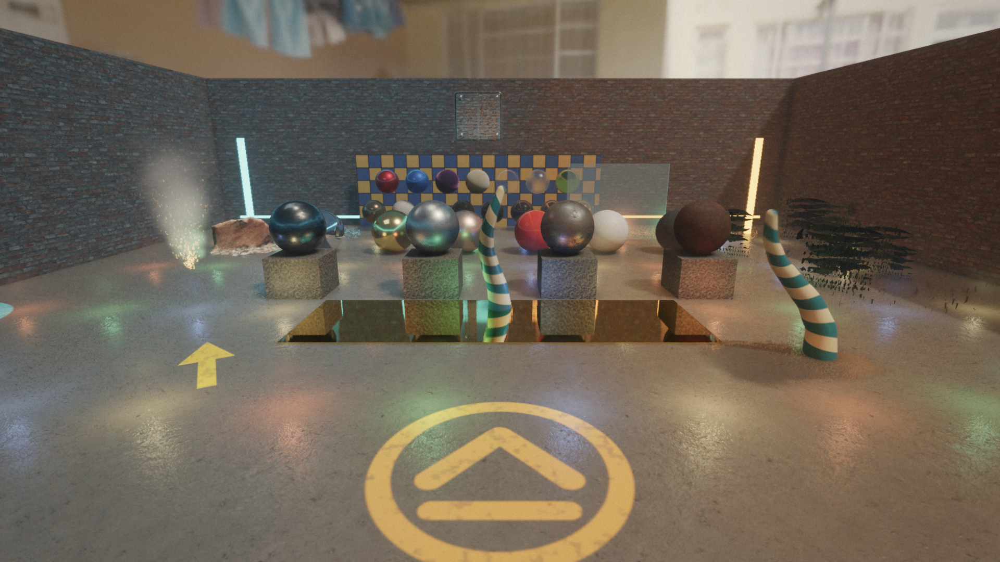

# Projects

Part of the [repository guide](../REPOSITORY_GUIDE.md).

## `src/engine/project/ProjectConfig.*`

Defines the shared versioned project manifest used by both game and editor
applications. Version 7 stores:

- a display name;
- project-relative asset and scene roots;
- a scene-root-relative startup scene;
- validated renderer quality and per-pass budget settings;
- an optional project-relative `gameModule` library path;
- optional `physicsLayers`: an array of `{"name", "collidesWith": [names]}`
  whose order gives each layer's index. A pair collides when either lists the
  other. Without it the project uses `PhysicsLayerTable::defaults()`;
- an optional project-relative `inputActions` file (see
  [Window and input](window-input.md)), whose actions replace the game
  module's actions of the same name and add new ones
  (`loadProjectInputActions`);
- optional `tags`: the tag names the editor offers for `TagsComponent`;
- optional `navigation` (version 7): the `NavMeshBuildSettings` the project's
  navigation meshes are built with, as an object of their fields by their C++
  names (`cellSize`, `agentRadius`, ..., `layerMask` as a number); a missing
  field keeps its default, and invalid values
  (`validateNavMeshBuildSettings`) are rejected on load and save.
  `navigationSettings()` gives them, or the defaults.

The game and the editor give the table to their `PhysicsWorld`, and apply the
action file over the module's actions (`ProjectApplication::onStart`, and
`GameModuleHost::setProjectInputActions` in the editor); a bad action file is
logged and the module's defaults are used. Both give the navigation settings
to the session's `OutsideServices::setDefaultNavigationSettings` when gameplay
starts, and the editor's `navigation.bake` uses them too, so the preview is
the mesh the game bakes. Versions 1 to 6 remain readable
and are upgraded on save. Scene references are validated against the scene root before
`SceneDocument` loads them. `loadProjectScene` and `loadProjectStartupScene`
take an optional component type registry (null means the built-in types) so a
game can load scenes holding its own components; `loadProjectSceneFile` loads
any scene file (such as an editor's `--scene` copy) with the project's asset
root.

`projects/demo.zenith-project` names its game module as
`modules/zenith_game_demo.zmodule`. The build copies the module there on every
build of `zenith_game_demo` (and of `zenith`, which depends on it) with a
platform-independent extension, so one checked-in project file works on every
platform and from any build directory, and the packaged project finds the
module at the same relative path. The copy is whichever configuration was
built last; an editor of another configuration refuses it by build hash, so
rebuild the module in the editor's configuration.

The `zenith` executable accepts `--project <project-file>` and
`--scene <scene-file>` (a `.zenith-scene` run in place of the startup scene;
the editor's standalone play target uses it), and plays the demo project
through its module. The demo application loads authored scene content through
this engine contract, then adds its game-specific player and behavior in
`src/game/`.

`projects/showcase.zenith-project` is the renderer test scene: alpha-tested and
blended materials, metals across a roughness ladder, emissive surfaces, a dense
photoscan, 52 clustered lights, a glossy floor, an HDR sky, animated skinned
tentacles, a mirror-smooth gold slab, a KHR material-extension gallery,
clustered decals, a GPU-particle campfire, volumetric fog, two blended
reflection probes and a baked irradiance volume. Its render settings enable
every renderer feature (TAA, GTAO, SSR, depth of field, motion blur, colour
grading); the reference captures under `tests/references/showcase/` show each
one. Its content is generated by `tools/showcase/` (see the README there) and
committed; `tests/engine/ShowcaseContentTests.cpp` checks the skinned, mirror
and feature content and the project's render settings.

`projects/irradiance_room.zenith-project` is the indirect-lighting test
interior: a closed room with red and green side walls, a window the sun shines
through, and no fill lights. Its baked irradiance volume shows bounce light and
color bleeding; switch the project's `indirectDiffuse` to `0` to compare with
environment-only indirect light. `tools/irradiance_room/build_irradiance_room.py`
regenerates the content, and
`zenith_editor projects/irradiance_room.zenith-project --bake-irradiance-volumes`
rebakes the volume and saves the scene.
